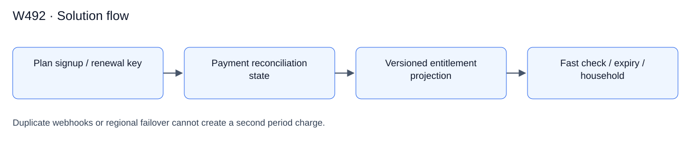

# W492. Design Walmart Plus Membership System

**Priority group:** Fifth 100 — specialized practice

**Category:** Web services and object design

**Study position:** 492 of 547

[Group list](../FIFTH_100.md) · [All categories](../ALL_CATEGORIES.md) · [Chapter guide](../README.md)

## Question

Design a paid-membership system (Walmart+ analog) covering signup, recurring billing, entitlement checks at read time, family/household plan sharing, and graceful handling of payment failures and cancellations.

### Requirements

Functional: signup with plan selection (monthly/annual/family); recurring billing with retry on failure; entitlement check API used by checkout, shipping, and streaming flows; cancellation with end-of-period grace; family/household member invitation and management; transactional emails for renewal, failure, and cancellation.
Non-functional: entitlement check on the read path must be sub-50 ms p99 (called inline during cart and product-page loads); billing pipeline must be idempotent under payment-gateway retries; membership state must remain consistent across data-center failover; PCI scope limited to a tokenized payment vault.
Data model: Member, Subscription (plan, period, status active/past_due/canceled/paused, current_period_start/end), Entitlement (cached projection: member_id -&gt; feature flags + expiry), PaymentMethod (token), BillingEvent (charge id, status, idempotency_key), HouseholdLink (primary_member_id, member_id, role).

## Worked solution

### Billing is a durable state machine; entitlement is a versioned projection

Use the supplied entities with primary keys and ownership links: `Member`, `Plan(version,price_cents,currency,interval,features)`, `Subscription(member,plan_version,status,period_start,period_end,cancel_at_period_end,version)`, `PaymentMethod(vault_token)`, `BillingEvent(subscription,period,idempotency_key,provider_charge_id,state)` and `HouseholdLink(primary,member,role,state)`. An entitlement projection stores feature flags, expiry, source subscription/household versions. Store no raw card number; only the tokenized vault/provider boundary handles it.

`POST /subscriptions` validates plan and starts a charge with stable `(subscription,period,attempt-purpose)` idempotency. Webhooks and a reconciliation job advance pending → paid/failed under unique provider event IDs and a single subscription version owner. A lost charge reply is queried/reconciled, not paid again with a new key. Renewal reserves the next billing job; success advances the period once and emits entitlement/email outbox events. Retry transient payment failures under a bounded schedule/dunning policy, then past_due and eventually suspended/canceled according to the explicitly chosen grace period. Do not infer grace length from the word “membership.”

Cancellation marks end-of-period nonrenewal, keeps paid entitlements until period_end and returns that timestamp. Immediate fraud/admin suspension is a different transition with faster invalidation. Concurrent cancel/renew/payment callbacks serialize on subscription/version; a late paid webhook cannot silently reactivate a canceled future period without a defined policy. Pause/resume/proration are explicit plan rules, not ad hoc status strings.

`GET /entitlements/{member}?feature=shipping` authenticates the trusted caller and returns allow, expiry, version/reason in<50 ms p99 through regional in-memory/Redis projections. Absolute expiry is checked on every hit; an expired projection never extends access by resetting its TTL. Strict revocation needs a current version/lease authority; eventual outbox propagation requires a stated small bound and fail-closed behavior for unknown/stale state. A household invitation is unique, expires, requires acceptance and checks plan capacity; transactional links prevent the same dependent consuming multiple conflicting primary plans.

At an assumed 10M members and 100K peak entitlement checks/s, 200-byte projections are 2 GB raw before replicas, while billing roughly monthly is much less frequent but correctness-critical. Replicate subscription/charge state with consensus/ownership fencing across data centers; a failed region cannot independently issue another renewal. Email delivery uses unique event/template keys and retries without duplicate charges. Monitor payment ambiguity, dunning, projection lag, entitlement p99, household churn and audit transitions; test failover after provider acceptance and cancellation at a period boundary.

### Follow the diagram

Read left to right: Plan signup / renewal key → Payment reconciliation state → Versioned entitlement projection → Fast check / expiry / household. Duplicate webhooks or regional failover cannot create a second period charge.

### Further study

- [F165: Design idempotency for an order or booking API.](../17_distributed_systems_depth.md#f165)
- [F170: Design a cache without serving incorrect data.](../17_distributed_systems_depth.md#f170)
