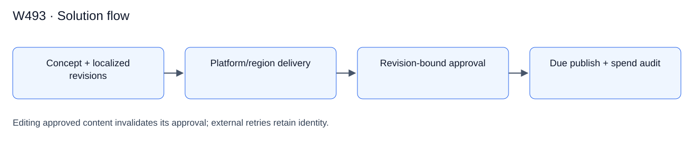

# W493. Promotion Posting System Data Model

**Priority group:** Fifth 100 — specialized practice

**Category:** Web services and object design

**Study position:** 493 of 547

[Group list](../FIFTH_100.md) · [All categories](../ALL_CATEGORIES.md) · [Chapter guide](../README.md)

## Question

Design the relational schema for Netflix's internal tool that posts trailers/clips/announcements to many social platforms (Facebook, YouTube, TikTok, Instagram, X) across regions and languages.

The schema must support:

Posting to many platforms, each with different rules (video length, aspect ratio, text length).
Different regions and languages (English in US, Japanese in Japan).
Money tracking (budgets and spend) rolled up by campaign / platform / region, stored in cents.
An approval workflow (managers approve before a post goes live).
Scheduling (post at a future time).
A full audit/history log of who changed what.

Scale: ~5K employees, ~20K campaigns/year, ~200K posts, ~30 translations each, ~30 regions, ~5–7 platforms. Read-heavy (dashboards + scheduler polling), not write-heavy.

Focus on tables, relationships, money handling, and extensibility (adding new platforms shouldn't break things).

## Worked solution

### Model a creative concept, its translations and each actual delivery

Use `Employee(id)`, `Campaign(id,name,owner,budget_cents,currency,version)` and `CampaignMember(campaign,employee,role)`. `PostConcept(id,campaign,source_locale)` owns `PostRevision(id,concept,revision,text,asset_manifest,author,created_at)`. `Localization(id,concept,locale,revision,text,asset_manifest,state)` stores each language variant rather than adding one column per language. `Region(id,code)` and `Platform(id,name,adapter_type)` are data rows so new platforms do not require schema branches.

`PlatformRule(platform,version,valid_from,max_video_seconds,aspect_ratios,max_text_length)` describes versioned constraints; validate a delivery against the rule version actually approved. `Delivery(id,localization_revision,platform,region,account_id,scheduled_at_utc,state,version,provider_post_id)` is one intended external post. Unique `(localization_revision,platform,region,account_id,purpose)` or a client idempotency key prevents accidental duplicates. A localization may be delivered to many platforms/regions without copying the whole campaign.

`Approval(delivery,revision,approver,decision,decided_at)` refers to exact content/rule revisions; changing approved text/media or schedule under policy returns it to review. States draft → pending_approval → approved → scheduled → publishing → published/failed. Scheduler claims due approved rows with lease/fence and an index on `(state,scheduled_at_utc,id)`, uses stable provider request keys and reconciles unknown external results. A retry cannot post a new revision that was never approved. Store source timezone for display, but schedule an unambiguous UTC instant.

Budget allocations live in `BudgetAllocation(campaign,platform,region,currency,amount_cents)`. Spend is an append-only `SpendEvent(id,delivery,currency,amount_cents,event_time,provider_reference)` with unique provider reference; credits are explicit signed events. Rollups group campaign/platform/region **and currency**, and reservations prevent overspend if required. Never sum cents across currencies without a versioned FX/reporting policy.

Append `AuditEvent(actor,entity,entity_id,old_version,new_version,action,patch,time,request_id)` in the same transaction/outbox as changes. At 200K concepts×30 translations ≈ 6M localization rows before revisions/deliveries, relational indexes and pagination are appropriate; this is read-heavy workflow data, not an excuse for a giant event-stream-only schema. Dashboards query indexed deliveries/materialized monetary aggregates. Foreign keys/unique constraints enforce ownership and revision links; add schema-compatible platform adapters/rules rather than hard-coded platform columns. Retain approval and provider evidence to explain who published exactly which content and why.

### Follow the diagram

Read left to right: Concept + localized revisions → Platform/region delivery → Revision-bound approval → Due publish + spend audit. Editing approved content invalidates its approval; external retries retain identity.

### Further study

- [F165: Design idempotency for an order or booking API.](../17_distributed_systems_depth.md#f165)
- [F170: Design a cache without serving incorrect data.](../17_distributed_systems_depth.md#f170)
