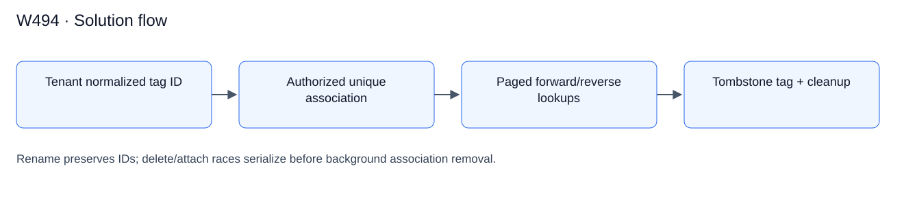

# W494. Tagging System REST API

**Priority group:** Fifth 100 — specialized practice

**Category:** Web services and object design

**Study position:** 494 of 547

[Group list](../FIFTH_100.md) · [All categories](../ALL_CATEGORIES.md) · [Chapter guide](../README.md)

## Question

Design a tagging system with REST APIs for creating tags, associating tags to resources, deleting tags, and finding tagged objects. Interviewers focus on API design details and edge cases more than broad architecture diagrams.

### Requirements

Support creating tags.
Support associating and disassociating tags with resources.
Support deleting tags and defining what happens to existing associations.
Support finding resources by tag and finding tags for a resource.
Define REST APIs, request/response shapes, and error cases.
Cover pagination for large result sets.
Notes
This round is API-design heavy; the interviewer may drill every operation before there is time for a full system diagram.
Be explicit about uniqueness, case sensitivity, tag rename semantics, and authorization boundaries.

## Worked solution

### Stable tag IDs, idempotent associations and explicit delete semantics

Choose tenant-scoped case-insensitive uniqueness using a documented Unicode normalization/casefold key, while preserving display case. Store `Tag(id,tenant,display_name,normalized_name,version,state)` unique `(tenant,normalized_name)` and `ResourceTag(tenant,resource_type,resource_id,tag_id,created_by,created_at)` unique on the full association. Tags reference resources by stable IDs; polymorphic resource existence/permission checks belong to the owning service or a resource registry.

| API | Request/result and errors |
|---|---|
| POST /tags | `{name}` →201 `{id,name,version}`; 400 invalid, 409 normalized duplicate |
| PATCH /tags/{id} | `{name}` plus If-Match →200 new version; 409 name conflict, 412 stale version |
| PUT /resources/{type}/{id}/tags/{tag_id} | Idempotently attach →204; 404 missing/inaccessible tag/resource, 403 where policy permits disclosure |
| DELETE /resources/{type}/{id}/tags/{tag_id} | Idempotently detach →204 even if absent |
| GET /tags/{id}/resources?cursor&limit | Ordered resource IDs/types and next cursor |
| GET /resources/{type}/{id}/tags?cursor&limit | Ordered tag IDs/names and next cursor |
| DELETE /tags/{id} | Tombstone immediately, then remove associations; 204 retry-safe |

Rename changes only tag display/normalized name, not association identity. Creation/deletion races serialize on the tag: attachment checks live state transactionally; a tombstoned tag cannot gain new associations during cleanup. Existing associations disappear from reads immediately through a live-tag join/filter, while a resumable worker deletes large join rows. State whether a recreated same name gets a new ID (here yes); old references do not silently reconnect.

Authenticate tenant and require tag-management permission for create/rename/delete plus resource-edit permission for attach/detach. Finding tagged resources filters by the caller's resource access; tag membership alone is not access. Use indexed `(tag_id,resource_type,resource_id)` and reverse `(resource_type,resource_id,tag_id)` within tenant. Keyset cursors bind tenant, query, sort and last key; limit maximum page size and define snapshot versus live pagination (choose live with immutable tie keys and documented concurrent-change behavior). A large tag must not return all associations in memory. Audit mutations and rate-limit expensive scans; unknown foreign-tenant IDs should not become an information oracle. This API-level precision matters more than a broad generic architecture.

### Follow the diagram

Read left to right: Tenant normalized tag ID → Authorized unique association → Paged forward/reverse lookups → Tombstone tag + cleanup. Rename preserves IDs; delete/attach races serialize before background association removal.

### Further study

- [F165: Design idempotency for an order or booking API.](../17_distributed_systems_depth.md#f165)
- [F170: Design a cache without serving incorrect data.](../17_distributed_systems_depth.md#f170)
