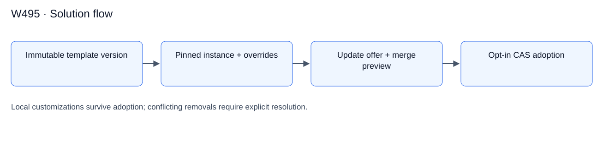

# W495. Template & Instance System with Update Propagation

**Priority group:** Fifth 100 — specialized practice

**Category:** Web services and object design

**Study position:** 495 of 547

[Group list](../FIFTH_100.md) · [All categories](../ALL_CATEGORIES.md) · [Chapter guide](../README.md)

## Question

Template & Instance System with Update Propagation

Design a template/instance model (Figma components, or online slide/PPT templates): a template defines a reusable object and instances customize it. When a template changes, instances should reflect the change — via a push notification letting the user choose whether to adopt the update.

### Requirements

Two related framings have appeared:

Component template/instance representation. A template (e.g. a button) has instances that override properties (text, color). Choose an efficient representation (JSON-like) so that when the template changes, instances update accordingly while preserving their local customizations.
Online slide/PPT template system. Users generate document instances from templates. When a template is updated, notify users of affected instances and let each user decide whether to adopt the new version. Start with a simple version first.
Notes
Core design decisions: how an instance stores overrides versus inherited template values (so template edits propagate but local customizations survive), template versioning, and the notify-and-opt-in update flow for documents.
Real-world scale here is low — candidates who modeled it as a massive high-concurrency system were seen as over-engineering. Start from the simplest correct representation and add propagation/versioning incrementally.
Frequently bundled into the broader Figma system-design rotation alongside the trending and real-time-comments prompts.

## Worked solution

### Pin the template version and store only local overrides

For a simple version, store `Template(id,owner,latest_version)`, immutable `TemplateVersion(template,version,property_tree)` and `Instance(id,owner,template_id,base_version,overrides,revision)`. Properties/nodes have stable IDs, not fragile array positions. Effective rendering merges base properties with explicit overrides; “unset/inherit” differs from an explicit null/delete override. Example base button `{text:Buy,color:blue}` and override `{text:Pay}` renders Pay/blue. A template changing color to green should produce Pay/green **only after adoption** in the opt-in document framing.

Publishing a template inserts an immutable version and outbox `TemplateUpdated`. A small worker finds dependent instances, writes unique `UpdateOffer(instance,target_version,state)` and notifies owners. `GET /instances/{id}/update-preview?target=v` computes a diff; `POST /instances/{id}/adopt` includes expected instance revision and target version. The user can adopt, postpone or dismiss; a notification does not mutate their document. For live components, explicitly choose an auto-follow policy rather than silently reusing it for opt-in slides.

Adoption uses a three-way merge: old template, local effective/overrides, new template. Preserve overridden properties; inherit changed unoverridden ones. If a template removes a node/property with local edits or changes its type, surface a conflict/orphan override and let the user keep a local copy or discard it. Renamed display labels keep the same stable property ID. Reset-to-template removes an override, rather than copying the current default and accidentally pinning it forever.

Transactionally update base_version and resolved overrides under instance revision CAS; concurrent local edit/adoption gets 412/conflict and a refreshed preview, not lost customization. Dedup offers/notifications by instance+target version, and newest offers can supersede older unadopted ones. Retain old versions for rendering/audit and rollback; deletion of a template must not break pinned instances. At an illustrative 10K templates and 100K instances, a relational index on template_id and a modest queue suffice. Start with JSON merge/diff plus explicit conflicts; avoid inventing a massive distributed propagation platform for the stated low-scale product.

### Follow the diagram

Read left to right: Immutable template version → Pinned instance + overrides → Update offer + merge preview → Opt-in CAS adoption. Local customizations survive adoption; conflicting removals require explicit resolution.

### Further study

- [F165: Design idempotency for an order or booking API.](../17_distributed_systems_depth.md#f165)
- [F170: Design a cache without serving incorrect data.](../17_distributed_systems_depth.md#f170)
