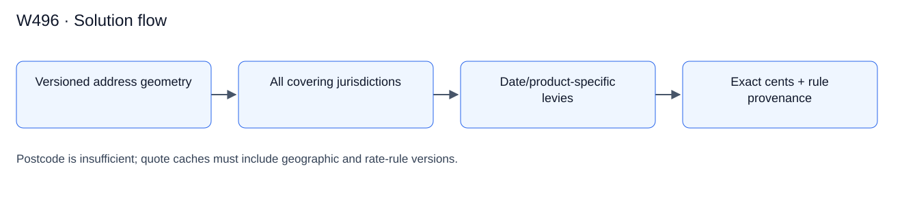

# W496. Design a Sales Tax Engine (Address + Date to Tax)

**Priority group:** Fifth 100 — specialized practice

**Category:** Business rules and transactional services

**Study position:** 496 of 547

[Group list](../FIFTH_100.md) · [All categories](../ALL_CATEGORIES.md) · [Chapter guide](../README.md)

<span class="practice-page"></span>

## Question

Online stores must charge the right sales tax on every order, and in the United States the amount depends on exactly where the goods are delivered and on the date of the sale. Design the service a store calls at checkout: it takes a delivery address, a transaction date and the order's line items, and returns the tax owed, broken down by jurisdiction and tax type. Most of the discussion is about the data model, so settle the schema first; serving and scaling come after it.

What to design

Inputs:

A delivery address (street, city, state, postcode, country).
A transaction date.
The line items: an amount in cents and a product tax code for each (for example general or prepared_food). The amounts are needed to turn rates into money; assume they are always present.

### Output

The total tax in cents.
One line per applied tax: the jurisdiction, its level (state, county, city, special district), the tax type, the rate, and the amount.
Questions to answer
1. Data model. Design the tables for jurisdictions, their boundaries, the tax types each one levies, and the rates. Requirements:
Jurisdictions overlap. One location can owe state, county and city tax at the same time, plus special districts (transit, stadium, school) whose boundaries ignore county and city lines.
One jurisdiction can levy several kinds of tax, and some apply only to certain product tax codes.
Rates change over time and must keep their history.
A rate that applies to a whole state is stored once, not copied to every place inside the state.
2. Postcodes. Explain why a postcode is not precise enough to decide the tax, and what you use instead.
3. The date. Explain what the transaction date is used for.
4. Caching. Lookups are served through Redis. Define the cache key(s) and explain why.
Example

Two addresses share the postcode 90001. Address A lies inside the state, county C1, city CX and transit district TR; address B lies inside the state and county C2 only. With state 6.00%, C1 1.00%, C2 0.50%, CX 2.00% and TR 0.50%:

A

```python
100.00
```

𝑔
𝑒
𝑛
𝑒
𝑟
𝑎
𝑙
𝑜
𝑟
𝑑
𝑒
𝑟
𝑜
𝑤
𝑒
𝑠

```text
100.00generalorderowes9.50 at A (6.00 + 1.00 + 2.00 + 0.50 percent) and USD 6.50 at B (6.00 + 0.50 percent), so the postcode alone cannot decide the tax.
```

If CX raises its rate to 2.25% from 2026-07-01, the same order at A dated 2026-07-15 owes

```python
9.75
```

,
𝑤
ℎ
𝑖
𝑙
𝑒
𝑜
𝑛
𝑒
𝑑
𝑎
𝑡
𝑒
𝑑

```python
2026
```

−

```text
06
```

−

```python
15
```

𝑠
𝑡
𝑖
𝑙
𝑙
𝑜
𝑤
𝑒
𝑠

```text
9.75,whileonedated2026−06−15stillowes9.50, because the rate is chosen by the transaction date.
```

Constraints and assumptions
United States only; about 13,000 taxing jurisdictions, including special districts.
Normal load about 2,000 checkout quotes per second; peak about 10 times that.
Checkout quote p99 under 100 ms.
A wrong rate is a compliance problem: answers must be reproducible for any past date.
Follow-up 1: real-time checkout and batch sync

The service has two traffic modes: real-time checkout quotes (low latency, one order at a time) and batch sync (a merchant uploads a day of transactions for filing or recalculation). Describe how each is served.

Follow-up 2: a 10x Black Friday peak

Checkout traffic rises about 10 times for a day. Describe how the system scales and what is warmed up in advance.

## Worked solution

### Settle the temporal/geographic schema first

Use `Jurisdiction(id,name,level)` where level is state/county/city/special district; `Boundary(jurisdiction_id,version,geometry,valid_from,valid_to,source)` with spatial indexes; `TaxType(id,name,calculation_rule)`; `Levy(id,jurisdiction,tax_type)`; and `Rate(levy_id,product_tax_code,rate_numerator,rate_denominator,valid_from,valid_to,rule_version)`. Enforce no overlapping effective intervals for the same applicable rule/priority. General/default and product-specific rules need explicit precedence/exemption semantics. A statewide levy is stored once on that state jurisdiction, not copied into every city/postcode.

`POST /quotes {address,transaction_date,items:[{amount_cents,product_tax_code}]}` returns total_tax_cents, applied lines `(jurisdiction,level,tax_type,rate,amount_cents)`, normalized location, rule/boundary versions and quote_id. Standardize/geocode the precise address using an authoritative versioned source, then point-in-polygon lookup returns **all** covering jurisdictions, including overlapping special districts. A postcode can cross county/city/district lines; its centroid cannot determine a compliance-sensitive boundary. Ambiguous/low-quality geocoding returns an explicit address-resolution error/review path, not a guessed rate.

The transaction date chooses both boundary and levy/rate effective history using `[valid_from,valid_to)`. Keep immutable rule releases and data-source evidence; store the quote's exact ruleset/geocode versions so a later correction can reproduce the originally issued answer and separately recalculate under corrected history. Amount calculation uses exact integer/rational or Decimal arithmetic with explicitly versioned per-line/jurisdiction rounding, caps and tax-on-tax rules when applicable. Do not assume all levies simply add for all products beyond the exercise's example.

For the provided 10000-cent general item, A uses 6%+1%+2%+.5%=9.5%=950 cents; B uses 6%+.5%=6.5%=650 cents. A on 2026-07-15 uses the example's new city 2.25%, yielding 975 cents, while 2026-06-15 remains 950. These are supplied fictional rule values, not current tax advice.

Redis caches split geography from rates: `geo:{normalized_address_hash}:{geocode_version}:{boundary_version/effective_period}`→jurisdiction IDs; `rates:{jurisdiction_set}:{product_code}:{effective_interval}:{ruleset_version}`→applicable rate rules. A cached final quote also needs the item amounts/product codes/rounding/merchant-context hash; address+date alone is insufficient. Expire/invalidate on new rule releases and use immutable versioned keys for historical reproducibility. Avoid putting raw personal addresses into visible cache key text.

At 2000 normal/20K peak quotes/s and 13K jurisdictions, keep current boundary/rate lookup structures warm regionally and batch/cache address resolution; an external geocoder on every checkout will likely exceed 100 ms p99/cost budgets. Real-time path has reserved capacity and deadlines; day-file batch sync uses the same rule engine in a separately throttled queue with per-row provenance/rejects and idempotent transaction IDs. Before Black Friday warm common geography/current product-rule sets, scale stateless calculators/cache replicas and rehearse failover. A stale/unverified ruleset must not be silently labeled correct. Monitor quote p99, geocode ambiguity, rule freshness, cache version mismatch and reconciled sample calculations. Exact jurisdiction rules beyond the supplied example require authoritative maintained data; the architecture does not invent them.

### Follow the diagram



Read left to right: Versioned address geometry → All covering jurisdictions → Date/product-specific levies → Exact cents + rule provenance. Postcode is insufficient; quote caches must include geographic and rate-rule versions.

### Further study

- [F165: Design idempotency for an order or booking API.](../17_distributed_systems_depth.md#f165)
- [F170: Design a cache without serving incorrect data.](../17_distributed_systems_depth.md#f170)
