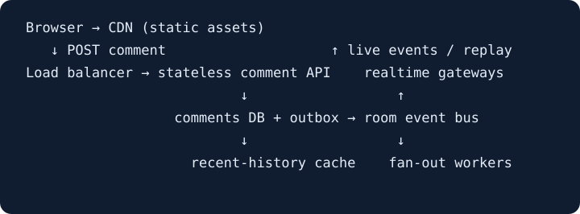

# W509. Design a Website for 100,000 Concurrent Users with Live Comments

**Priority group:** Final 47 — complete coverage

**Category:** Frontend and full-stack systems

**Study position:** 509 of 547

[Group list](../FINAL_47.md) · [All categories](../ALL_CATEGORIES.md) · [Chapter guide](../README.md)

## Question

Design a website that can serve 100,000 users online at the same time and offers a live comment feature: users post comments and everyone watching sees new comments almost immediately.

What to deliver
1. Requirements: functional (post, view live stream, load recent history) and non-functional (concurrency, latency, availability).
2. A high-level architecture covering load balancing, the stateless web tier, the real-time messaging tier, storage and caching.
3. A back-of-the-envelope estimate of the bandwidth to reserve: ingress for posted comments and egress for fan-out to viewers, with your assumptions stated.
4. A UML-style diagram (component or class diagram) of the comment service.
5. Scaling, trade-offs and failure handling: ordering, backpressure, hot rooms, multi-region, recovery.

### Constraints

100,000 concurrent connections.
End-to-end delivery of a comment to viewers in well under a second.
No single point of failure; capacity must scale out horizontally.

## Worked solution

### State traffic assumptions before sizing

Assume 100,000 attached viewers, an average room of 100 viewers, one posted comment per user per minute, a 500-byte stored comment/event payload, and a delivery target below one second under the designed load. Average ingress is $100{,}000/60\approx1{,}667$ comments/s, or 0.833 MB/s payload. Fan-out is about 166,667 deliveries/s, or 83.3 MB/s (0.667 Gbit/s) before protocol/TLS overhead, retries and headroom.

If all viewers watch one global room, the same posting rate means 166.7 million deliveries/s and 83.3 GB/s payload. Concurrency alone therefore cannot determine bandwidth. For example, a twofold framing/overhead allowance and threefold peak allowance multiplies the first estimate by six; validate with actual messages and room distribution. Global-room traffic may require product rate limits/aggregation because no client can usefully render 1,667 comments/s.

### Component diagram and request flow

[Open the architecture diagram](../diagrams/W509_review_architecture.svg).

The comment API authenticates membership, validates/rate-limits content and accepts a client idempotency key. In one transaction it inserts the comment with a room sequence and an outbox event. Publishing can retry; consumers deduplicate event IDs. `GET /rooms/{id}/comments?before=seq&limit=50` provides history, while WebSocket or SSE delivers new events. SSE is sufficient for server-to-client comments when posting uses HTTP; WebSocket is useful if the product needs a bidirectional channel.

### Ordering and scale

Partition ordering by room rather than imposing an expensive global sequence. A unique `(room_id, sequence)` supports stable merge/replay; clients order/deduplicate by it and request gaps. Persist before acknowledging acceptance or broadcasting as durable. The API tier scales by request load and gateways by tested connection count, memory and egress. Replicate stores/brokers across failure domains and use reconnect backoff to avoid a connection storm.

Hot rooms need hierarchical fan-out: one ordered room stream feeds several regional/gateway subscribers rather than one database query per viewer. Slow clients get bounded buffers; disconnect them with a replay cursor or offer a sampled/paused mode rather than exhausting server memory. Cache recent comments with a database fallback and keep deletion/moderation events versioned so replay does not resurrect removed content.

For multiple regions, choose a home writer for each room, replicate history and fan out locally. Cross-region latency and failover ordering need an explicit epoch/fencing scheme; two unrestricted writers cannot both promise one simple total room order during a partition. On writer loss, promote under a lease/consensus decision, replay durable events and deduplicate. Monitor publish-to-delivery p99, queue age, reconnects, dropped buffers, per-room skew and history/live-stream reconciliation. A browser disconnect should cause replay, not a lost accepted comment.
