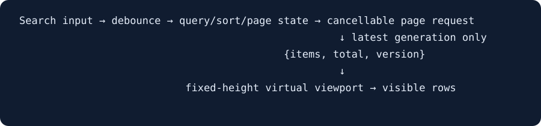

# W510. Front-end Large Scale Data Rendering with React

**Priority group:** Final 47 — complete coverage

**Category:** Frontend and full-stack systems

**Study position:** 510 of 547

[Group list](../FINAL_47.md) · [All categories](../ALL_CATEGORIES.md) · [Chapter guide](../README.md)

<span class="practice-page"></span>

## Question

Front-end Large Scale Data Rendering and Sorting Optimization

Implement a component using React and ES6 that supports pagination, sorting, and searching large-scale data. Utilize virtualization (such as react-window or react-virtualized) to improve rendering efficiency.

### Requirements

Support rendering over 100,000 data entries on the frontend.
Implement pagination, sorting, and searching functionalities.
Optimize API requests to improve efficiency.
Notes
Utilize React lifecycle methods to improve performance.
Use ES6+ methods to improve code quality.
Consider performing sorting on the backend or using Web Workers to avoid UI stalling.
Test Cases
Input: 10,000 random data entries, check pagination and sorting effectiveness.
Input: Search criteria, evaluate search result correctness and performance.
Verify smooth scrolling with virtualized view.
Modify data entries multiple times and check response time.

## Worked solution

### Distinguish data work from DOM work

Virtualization renders only the visible rows. It does not make searching/sorting 100,000 records cheap, nor should sorting the current page be presented as sorting the whole dataset. Choose server-side filtering/sorting and pagination, then virtualize each fetched page. Assume fixed-height rows and an existing API that sorts the entire matching dataset before slicing a page.



[Open the architecture diagram](../diagrams/W510_review_architecture.svg).

### React implementation

[Download the component](../LargeList510.jsx). Inject a stable `fetchPage` function returning `{items,total,version}`. It must respect the requested global sort, include a unique-ID tie-break for equal sort values and forward the AbortSignal to fetch.

```jsx
import React, {useEffect,useRef,useState} from 'react';

// fetchPage({query,sort,direction,page,pageSize,signal}) -> {items,total,version}
export function LargeList({fetchPage, dataVersion = 0}) {
  const [text,setText]=useState('');
  const [query,setQuery]=useState('');
  const [sort,setSort]=useState('name');
  const [direction,setDirection]=useState('asc');
  const [page,setPage]=useState(0);
  const [result,setResult]=useState({items:[],total:0});
  const [status,setStatus]=useState('loading');
  const [scrollTop,setScrollTop]=useState(0);
  const generation=useRef(0);
  const viewport=useRef(null);
  const pageSize=1000, rowHeight=40, height=400, overscan=4;
  useEffect(() => {
    const timer=setTimeout(() => {setQuery(text.trim());setPage(0);},250);
    return () => clearTimeout(timer);
  },[text]);
  useEffect(() => {
    const current=++generation.current;
    const abort=new AbortController();
    setStatus('loading'); setScrollTop(0);
    if(viewport.current) viewport.current.scrollTop=0;
    fetchPage({query,sort,direction,page,pageSize,signal:abort.signal})
      .then(data => {
        if(current===generation.current && !abort.signal.aborted) {
          setResult(data);setStatus('ready');
        }
      }).catch(error => {
        if(current===generation.current && !abort.signal.aborted) setStatus('error');
      });
    return () => abort.abort();
  },[query,sort,direction,page,fetchPage,dataVersion]);
  const start=Math.max(0,Math.floor(scrollTop/rowHeight)-overscan);
  const end=Math.min(result.items.length,Math.ceil((scrollTop+height)/rowHeight)+overscan);
  return <section>
    <label>Search <input value={text} onChange={e=>setText(e.target.value)}/></label>
    <label>Sort <select value={sort} onChange={e=>{setSort(e.target.value);setPage(0);}}>
      <option value="name">Name</option><option value="updatedAt">Updated</option>
    </select></label>
    <button onClick={()=>{setDirection(d=>d==='asc'?'desc':'asc');setPage(0);}}>
      {direction==='asc'?'Ascending':'Descending'}
    </button>
    <button disabled={page===0 || status==='loading'} onClick={()=>setPage(p=>p-1)}>Previous</button>
    <button disabled={(page+1)*pageSize>=result.total || status==='loading'}
      onClick={()=>setPage(p=>p+1)}>Next</button>
    <p aria-live="polite">{status==='ready'?`${result.total} results, page ${page+1}`:status}</p>
    {status==='ready' && <div ref={viewport} style={{height,overflowY:'auto'}}
      onScroll={e=>setScrollTop(e.currentTarget.scrollTop)}>
      <ul aria-label="Results" style={{height:result.items.length*rowHeight,
          position:'relative',margin:0,padding:0,listStyle:'none'}}>
        {result.items.slice(start,end).map((item,offset)=>{
          const index=start+offset;
          return <li key={item.id} aria-setsize={result.total}
            aria-posinset={page*pageSize+index+1}
            style={{position:'absolute',top:index*rowHeight,height:rowHeight,left:0,right:0}}>
            {item.name}
          </li>;
        })}
      </ul>
    </div>}
  </section>;
}

```

The list reserves the full page height but mounts roughly ten visible rows plus overscan. Scrolling changes the slice; absolute row positions preserve the scrollbar. Pagination bounds the downloaded working set to one thousand rows even if total is above 100,000. Search is debounced by 250 ms, prior requests are aborted and a generation number rejects late responses even if cancellation is ignored. Effects clean up timers/requests when dependencies change or the component unmounts.

### API efficiency and changing data

Memoize `fetchPage` in the consuming app so its changing function identity does not refetch forever. Add a bounded cache keyed by normalized query, global sort, direction, page and data version; use ETags or short freshness policies where appropriate. A mutation increments `dataVersion` or invalidates affected cached queries and refetches the visible page. When filtering/deletion makes the page index invalid, clamp it using the returned total and request the nearest valid page.

Offset pages are easy for this sketch but can skip/duplicate entries during concurrent inserts. For a live mutable dataset, prefer cursor pagination over a stable `(sort_value,id)` order and, when necessary, a snapshot/version token. If the backend cannot perform global search/sort, load the full data intentionally and move that work into a Web Worker; copying 100,000 objects and stale worker results still need versioning and measurement.

### Test the user-visible behavior

Test the API contract with known records where a correct globally first item begins on another page. Use fake timers to verify the debounce and controlled promises to verify old responses never replace newer results. For 100,000 mocked records, assert the DOM row count remains near viewport plus overscan and check scroll positions at the beginning/middle/end. Exercise rapid search/sort/page changes, unmount, empty/error results and repeated mutations. Profile frame time and request count in a browser; a successful JSX compilation is not evidence of smooth scrolling.

Fixed-height virtualization requires truly fixed rows; wrapping text needs measurement or a variable-height virtualizer. Preserve list positions for assistive technology, and provide paginated/nonvirtual alternatives when users need reliable full-list navigation. This sample demonstrates the implementation; browser performance remains a measurement on the target application/device.
