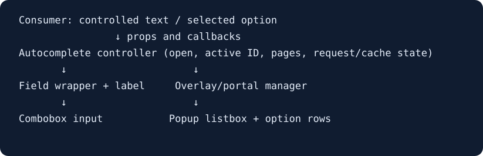

# W511. Frontend System Design: Autocomplete Search Input

**Priority group:** Final 47 — complete coverage

**Category:** Frontend and full-stack systems

**Study position:** 511 of 547

[Group list](../FINAL_47.md) · [All categories](../ALL_CATEGORIES.md) · [Chapter guide](../README.md)

<span class="practice-page"></span>

## Question

Design a reusable autocomplete search input for a React component library. As the user types, the input shows matching suggestions from a search API in a dropdown, and the user can pick one with the mouse or the keyboard. Other product teams will import your component, so its public interface matters as much as its internals.

The search backend already exists. Do not design the index, the ranking or the server; the whole design is on the client.

What to design
1. The API contract: the request your component sends (query text, page size or limit, pagination cursor), the response shape it expects, and how it asks for the next page.
2. Component architecture: how the input, its label, the field wrapper, the dropdown popup, and the portal that renders the dropdown outside the parent's DOM fit together, and what a portal manager does when several overlays are open.
3. Request timing: throttling versus debouncing keystrokes, which one you choose and why, and how you prevent a slow, stale response from overwriting a newer one.
4. Local result caching: compare an LRU cache of past queries, reusing cached results for a longer query with the same prefix, and a preloaded set of popular results. Say when each is correct and how the cache is invalidated.
5. The public interface: the React props a consuming team passes (for example, how suggestions are fetched, how an option is rendered, what happens on select) and which state is controlled by the consumer.
6. Exported versus internal components: which pieces the library exports and which stay private, and why.

### Requirements

Keyboard support: arrow keys move the highlighted option, Enter selects, Escape closes the dropdown.
Accessibility: follows the standard combobox pattern so screen readers announce the options.
The dropdown must not be clipped by a parent with overflow: hidden and must layer correctly inside a modal.
Results for the latest query always win over results for an earlier query.

### Constraints

Client side only, in React; assume a modern browser.
No particular scale is given: state what you assume about suggestion count, typing speed and API latency.
This is a design discussion with no runnable tests. Use a component diagram, a props interface and short code sketches where they help.
Follow-up 1: two autocompletes at once

Two autocompletes are open on the same page. Which one owns Escape and outside clicks?

Follow-up 2: testing

How would you test the debounce timing and the keyboard behaviour?

Follow-up 3: very long lists

Should the dropdown list be virtualised, and what does that do to accessibility?

## Worked solution

### Public contract and component boundaries

Assume ten to twenty displayed suggestions, typing around five keys/s and API latency 100–500 ms. The client accepts a provider function instead of hardcoding a URL:

```typescript
type Option = {id: string; label: string};
type Props = {
  value: string;
  onValueChange: (value: string) => void;
  loadOptions: (request: {query: string; limit: number; cursor?: string;
                         signal: AbortSignal}) => Promise<{
                           items: Option[]; nextCursor?: string}>;
  onSelect: (option: Option) => void;
  renderOption?: (option: Option, active: boolean) => React.ReactNode;
  label: string; disabled?: boolean;
};
```

Use `loadOptions({query,limit:20})` for the first page and the response cursor for subsequent pages under the **same** query/filter context. Deduplicate IDs when appending. Export `Autocomplete`, its public types and, if the library deliberately supports composition, documented styling primitives. Keep request generation IDs, cache machinery and highlight/portal internals private so consumers do not depend on unstable implementation details.



[Open the architecture diagram](../diagrams/W511_review_architecture.svg).

### Requests and cache correctness

Choose a roughly 200 ms debounce to avoid sending every keystroke, while showing loading state and keeping typing immediate. Throttling emits periodically during sustained input; it can suit continuous updates but sends more intermediate queries. Abort the previous request and also compare a monotonic request generation before committing results. Cancellation alone is insufficient if a provider ignores it. Reset active option/pagination when query context changes.

An LRU cache reuses **exact query plus locale/filter/user scope** results within a TTL, including cursor pages. A longer-prefix query may be filtered from a shorter-prefix cache only if the cached set is complete and the backend's matching/ranking semantics permit it; a top-twenty prefix result cannot represent every match for a longer query. Preloaded popular options help empty input and common requests but do not prove freshness or personalized relevance. Invalidate on account/locale/filter/provider-version changes and sensitive data boundaries.

### Accessibility, overlays and input behavior

Use a labeled input with `role="combobox"`, `aria-expanded`, `aria-controls`, `aria-autocomplete="list"` and `aria-activedescendant` pointing to a mounted option in a `role="listbox"`. Arrow keys update the active option and scroll it into view; Enter selects, Escape closes, and focus generally stays in the input. Mouse selection must not be lost when input blur runs first. Handle IME composition so Enter does not prematurely select while text is being composed.

Render the popup in a portal to escape clipping, position it relative to the input and update on scroll/resize. The portal manager tracks overlay ancestry, z-order and dismissal ownership, including the correct modal container/focus scope. A portal outside a modal must not accidentally become inert or hidden from assistive technology. With two open inputs, Escape goes to the topmost applicable active overlay and outside clicks dismiss according to that stack, not every dropdown on the page.

### Tests and large lists

Use fake timers for debounce, controlled promise resolution for stale-response races, keyboard tests for active ID/selection/Escape, pointer/blur tests and accessibility checks inside an overflow-hidden modal. Test both autocomplete instances together and cache separation between users. Virtualize only when a long list actually needs it: retain the active option in the mounted range, preserve correct option IDs/positions and test screen-reader navigation. Twenty suggestions usually do not justify that complexity.
