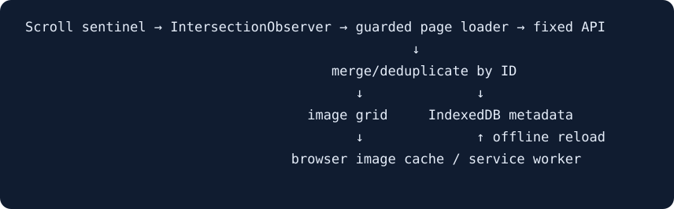

# W512. Frontend System Design: Infinite-Scroll Image Feed

**Priority group:** Final 47 — complete coverage

**Category:** Frontend and full-stack systems

**Study position:** 512 of 547

[Group list](../FINAL_47.md) · [All categories](../ALL_CATEGORIES.md) · [Chapter guide](../README.md)

## Question

Frontend-leaning system design: build an infinite-scroll image feed (no like/comment surface) against a fixed backend API. The interviewer scores explicitly on three axes: infinite-load mechanics, offline support, and testability.

## Worked solution

### Use a cursor-driven feed state machine

The backend API is fixed, so first document its actual page/cursor, ordering and image-URL contracts. Assume it returns `{items,nextCursor}` with stable IDs. The client owns items by ID, display order, next cursor, loading/error state and an `endReached` flag. Do not invent a backend ranking service for this frontend task.

[Open the architecture diagram](../diagrams/W512_review_architecture.svg).

An observer near the viewport bottom starts the next page only when no request for that cursor is running and there is another cursor. Append items in server order, deduplicate IDs and commit the new cursor with the page. Observe errors as explicit retryable states; a repeated callback must not start duplicate requests. Abort obsolete requests after a feed/filter reset and use a generation check so they cannot append to a different feed.

### Keep loading and rendering cheap

Reserve image dimensions or aspect ratio to avoid layout shifts, request appropriately sized images, lazy-load below-fold images and show placeholders/error alternatives. Limit concurrent image loads and prefetch only a small distance ahead. Virtualize or window a very long grid when memory/DOM profiling requires it, preserving scroll anchors and accounting for variable image heights. A visible “Load more” button is a useful accessible fallback to the sentinel.

### Make offline support explicit

Persist a bounded metadata/page cache in IndexedDB keyed by feed context and version, plus image assets under a cache/storage budget. On startup, show cached content and its freshness/offline state, then revalidate when online. Browsers can evict storage, so offline availability is a best-effort cache contract unless the product offers an explicit download flow. Failed uncached images need a clear placeholder; do not spin infinitely while offline.

Do not store credentials or indefinitely cache private images; partition caches by user and clear them on logout/account change. The page/cursor contract determines whether old cursors remain usable. If a refresh invalidates the cursor, start a new feed generation and preserve a meaningful visual anchor rather than appending incompatible pages. A service worker can cache eligible responses/assets, but cross-origin response and authentication rules still apply.

### Design for deterministic tests

Inject the page loader, clock, connectivity indicator and persistence adapter. Unit-test page merging, duplicate IDs, end-of-feed and retry state. Mock IntersectionObserver to verify only one request per cursor. Resolve requests out of order during a reset. Integration-test offline reload with cached metadata and partial image cache, quota eviction, reconnect revalidation and account changes. Browser-test scroll anchoring, slow/failed images, keyboard load-more and bounded DOM/memory growth. These three axes—infinite loading, offline semantics and controllable tests—are the core of this design.
