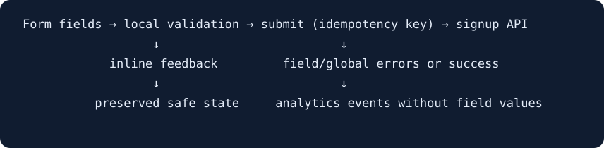

# W513. Frontend System Design: Signup Form with A/B Testing

**Priority group:** Final 47 — complete coverage

**Category:** Frontend and full-stack systems

**Study position:** 513 of 547

[Group list](../FINAL_47.md) · [All categories](../ALL_CATEGORIES.md) · [Chapter guide](../README.md)

## Question

Conversational frontend system-design round: design a signup form. No diagram required — the interviewer walks the signup flow asking how you would handle each decision:

Field set (email / password / region / referral code).
Client-side validation (per-field rules, debounced async checks like username availability).
Server-side validation feedback (error surfacing, retry behavior).
Multi-step vs single-page form.
Tracking and analytics (instrument funnel drop-off without leaking PII).
A/B testing variations (copy, field reordering, multi-step vs single-step) — what you measure and how you split.
Accessibility, error recovery, browser back-button behavior.

Despite the 'no right answer' framing, the interviewer has specific expected answers; A/B testing fluency is the recurring signal.

## Worked solution

### Define the smallest successful flow

Use email, password and only a region field genuinely needed for eligibility/localization; make referral code optional. Explain why each field exists. A short form can stay on one page; a long flow may use steps to reduce perceived complexity, but steps can hide total effort and complicate recovery. Test that choice rather than assuming multiple steps are always better.

[Open the architecture diagram](../diagrams/W513_review_architecture.svg).

### Validate without trapping the user

Use appropriate native input types/autocomplete hints and accessible labels. Validate local syntax after blur or meaningful edits; show concise errors near fields and an error summary on submit. Do not block ordinary typing with a premature invalid-email message. Password requirements must match the server. Debounce an optional availability check, abort old requests and ignore stale responses. Avoid revealing unnecessary account-existence information.

Server validation remains authoritative. Map structured field error codes back to their controls and surface a global error for service failure. Preserve safe inputs after failure, focus the error summary/first invalid field and prevent accidental duplicate submits. A request timeout means the server might have succeeded; use an idempotency key/status-safe retry instead of creating duplicate accounts. Do not persist a raw password in local storage or analytics.

### Back-button and recovery behavior

For steps, represent the step in navigation state so browser Back changes the step predictably without resubmitting. Keep nonsensitive draft state in memory or explicitly scoped short-lived storage when needed; revalidate it before submission. Let users edit earlier fields without silently clearing later valid data. After completion, redirect in a way that does not repeat the signup POST on Back. If email verification is required, show a pending-verification state and a rate-limited resend path rather than claiming the account is fully ready.

### Instrument an honest A/B test

Log pseudonymous experiment assignment, form view, step view, validation-error category, submit attempt, server success and verification completion. Never include email/password/referral free text in event payloads or URLs. Define the denominator before treatment, such as eligible unique form visitors, and avoid counting repeated renders as new users.

Randomize stable visitors/accounts before rendering and keep assignment sticky through the flow. Compare verified signup completion as primary, with abandonment by step, completion time, accessibility problems, invalid submissions, abuse and support contacts as guardrails. Copy, order and single-versus-multistep variants should have clear hypotheses; avoid changing all factors without a design that can identify their effects. Predeclare sample size/duration and account for multiple comparisons or use a valid sequential approach. Check exposure/sample-ratio consistency and cross-device limitations. A higher submit click rate without more valid verified accounts is not a successful signup experiment.
