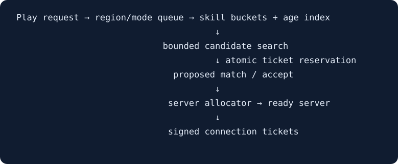

# W514. Design a Matchmaking Service for Multiplayer Games

**Priority group:** Final 47 — complete coverage

**Category:** Games, simulations and object design

**Study position:** 514 of 547

[Group list](../FINAL_47.md) · [All categories](../ALL_CATEGORIES.md) · [Chapter guide](../README.md)

## Question

Design a matchmaking service that places players into balanced multiplayer sessions. Players enter a queue, are grouped by skill into teams of a fixed size (commonly 16), and are allocated to a freshly provisioned game server. Focus on queue partitioning, the skill-bucketing strategy, the time-vs-fairness trade-off as wait time grows, and preventing matches from leaking across regions.

## Worked solution

### Define a ticket and its ownership

A matchmaking ticket contains party/player IDs, skill estimate and uncertainty, selected mode/team size, region/latency eligibility, enqueue time and cancellation/version state. Clarify whether sixteen means total players or players per team. Assume sixteen total and two teams of eight for this answer. Match quality balances team skill, acceptable latency and queue time; it is not simply sixteen adjacent rating numbers.

[Open the architecture diagram](../diagrams/W514_review_architecture.svg).

### Partition safely and widen deliberately

Partition first by region and game mode/rules. Inside a partition use rating buckets plus an age-ordered index, considering adjacent buckets for older tickets. A wait-dependent skill window, such as $w(t)=w_0+at$ up to a product-defined cap, increases match probability over time. Keep hard latency/region restrictions separate: widening rating tolerance must never accidentally widen the queue key into another region.

Form a candidate group preserving parties, then choose teams minimizing skill imbalance and party-size asymmetry. Ratings with uncertainty can prioritize provisional matches. Give oldest eligible tickets priority so new arrivals do not indefinitely displace them. If the target wait cannot be met without violating hard constraints, show a longer wait or request consent to another region/mode rather than silently crossing it.

### Reserve, allocate and recover

Atomically change tickets from QUEUED to RESERVED under one match ID, using compare-and-swap/version checks or a partition owner. Concurrent matchmakers must not place one player in two matches. Recheck cancellation and eligibility before committing. Reserve a server from a warm pool to reduce provisioning time; launch additional capacity asynchronously.

The allocator is idempotent by match ID. If server preparation fails, retry allocation within a deadline or release reservations with their original wait age. If players decline or never connect, use an explicit backfill/requeue policy; do not leave tickets reserved forever. Signed connection tickets bind a player, region, server and expiry. A region-specific allocator rejects mismatched region IDs even if upstream code errs.

Monitor queue age by region/rating/mode, skill gap, team imbalance, reservation conflicts, abandonment and server-start failures. Test concurrent matchmakers, duplicate Play requests, cancellation races, empty skill ranges and a full region outage. Capacity comes from measured arrival rate and acceptable wait via Little's law; adding matchmaker workers cannot fix too few compatible players.
