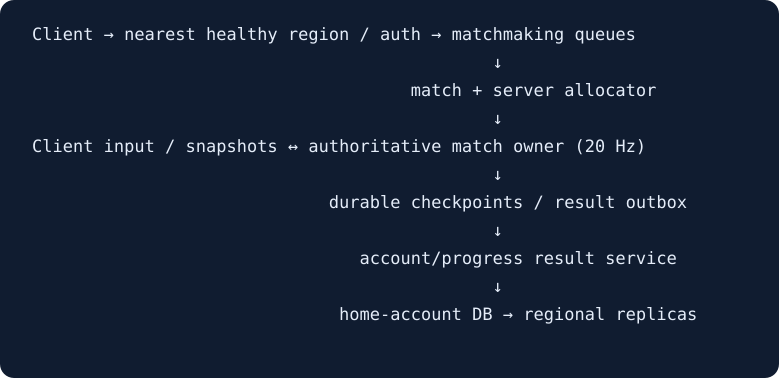

# W515. Design a Real-Time Multiplayer Game Backend

**Priority group:** Final 47 — complete coverage

**Category:** Games, simulations and object design

**Study position:** 515 of 547

[Group list](../FINAL_47.md) · [All categories](../ALL_CATEGORIES.md) · [Chapter guide](../README.md)

<span class="practice-page"></span>

## Question

Design the backend for a simple real-time multiplayer game. Players in many countries join short matches of a few people, send actions many times a second, and expect to see the other players' actions almost at once. Players also have accounts with progress that follows them wherever they connect. You design the whole path: how a client talks to the game, how players are grouped into matches, where each match runs, how state is kept consistent, and what is stored.

### Requirements

1. Gameplay: a match has 2 to 8 players. Each client sends inputs continuously. All players in the match see one shared world state, updated about 20 times a second. A match lasts 5 to 15 minutes.
2. Real-time communication: choose the protocol between the client and the game, and justify it for a game that runs in both native apps and browsers.
3. Matchmaking: a player presses "play" and is placed into a match with similar skill and acceptable latency. The target is a wait of about 10 seconds.
4. Multi-region: players are spread across the world. The system runs in several regions, and a player should connect to a nearby one.
5. High availability: the loss of a game server, a data store node or a whole region must not take the game down for everyone.
6. Eventual consistency where it is allowed: account data may be replicated asynchronously between regions. State inside a live match needs a precise answer of its own.
7. Low latency: the round trip between a player and the game should stay under about 80 ms for most players.
Scale assumptions (assumptions for this exercise, not given facts)

```text
2 million players online at peak, in 6 regions, the largest holding 30% of them.
```

A player session lasts about 15 minutes. About 90% of the online players are inside a match at any moment; the rest are in menus, lobbies or the queue.
A match has 6 players on average (2 to 8) and lasts about 13.5 minutes.
Each client sends 20 inputs per second of 50 bytes each. Each client receives one 200-byte state snapshot per tick, so 200 bytes is the whole update for one player, not for one entity.
One game server hosts about 100 matches. A stored match result is about 2 KB.
Non-goals
Game rules, graphics, or anti-cheat in depth (state where cheating would be detected, not how).
Payments and store design.
Voice chat.
Deliverables
1. The client protocol and the message flow of one match from "play" to results.
2. The matchmaking queue: its structure, partitioning, and how a long wait is handled.
3. The region strategy: where matches run, and how the database is laid out across regions.
4. The data model, and how concurrent updates are handled both inside a match and across regions.
5. Back-of-envelope sizing for match servers, bandwidth, queue length and write rates.
6. Failure behaviour for a game server crash, a region outage and a slow player.
Follow-ups
Follow-up 1: a player's connection drops mid-match and returns 20 seconds later on another network.
Follow-up 2: friends in different regions want to play together.
Follow-up 3: a currency balance that is changed by matches in two regions at nearly the same moment.

## Worked solution

### Choose authority and transport first

Each match has one authoritative game process updating the world at twenty ticks/s. Clients send input sequence numbers, not trusted new world positions. Native apps can use a UDP-based transport with selective reliability; browsers can use WebRTC data channels for similar semantics, with secure WebSocket as a simpler reliable ordered fallback. WebSocket's head-of-line blocking can hurt under packet loss, so measure it for the actual game. Authentication/lobbies use HTTPS/WebSocket regardless.



[Open the architecture diagram](../diagrams/W515_review_architecture.svg).

### Follow one match

A Play request carries an idempotent ticket ID, mode, party and measured region latencies. Queues partition by region/mode and index skill plus age. Widen skill bounds with wait time, retaining a hard latency policy and aiming for roughly ten seconds where player supply permits. Reserve all tickets atomically before allocating a warm server. Issue expiring player/match connection tokens.

The match owner orders inputs by tick and validates allowed actions. Snapshots contain authoritative tick and last processed input sequence so clients can reconcile/predict/interpolate. The server serializes state changes inside a match; eventual consistency is not appropriate for competing writes to one live world. Anti-cheat validation belongs at this authority boundary even though detailed detection is out of scope.

### Size the given workload

Ninety percent of two million online players is 1.8 million in matches. At six players each, there are **300,000 matches** and, at one hundred matches/server, **3,000 game servers** before spare capacity. The largest region has 90,000 matches and about 900 servers. CPU/memory/network benchmarking must confirm the assumed one-hundred-match density.

At peak, input payload is $1.8\mathrm M\times20\times50=1.8$ GB/s (14.4 Gbit/s), and output is $1.8\mathrm M\times20\times200=7.2$ GB/s (57.6 Gbit/s). Two hundred bytes is already a whole per-player snapshot; do not multiply by entities or players again. Add transport overhead, redundancy and peaks. The largest region carries 30% of those totals.

At 810 seconds/match, steady peak completion is $300{,}000/810\approx370$ matches/s, or 2,222 player placements/s. A ten-second matchmaking wait implies about **22,222 queued players** under these steady-flow assumptions. This is less than all 200,000 nonplaying users because menus/lobbies also hold users. Results at two KB each require about 0.741 MB/s or 64 GB/day **if peak persists all day**. Applying results to six player accounts averages about 2,222 player-result updates/s, plus ledger/index writes.

### Data and failure semantics

Store accounts/profiles, per-mode skill, ticket state, match ownership/lease, checkpoint references and immutable match results. Match IDs and unique `(match_id,player_id)` result applications prevent duplicate rewards. Replicate ordinary profile/preferences asynchronously. Currency needs a single-writer account ledger or coordinated transaction, not conflicting last-write-wins balances across regions.

A disconnected player reconnects with authentication and match ID, receives the latest full snapshot, and resumes with a new connection epoch; ignore packets from its old network/session. Keep a twenty-second grace policy explicit. Slow players cannot stall ticks: bound input buffering and use last/no-op input according to game rules.

For process crashes, choose durable checkpoints and recovery with a documented rollback/pause limit, or abort the affected casual match fairly when recovery cannot meet correctness. Lease fencing prevents two recovered owners. A region outage reroutes new sessions and preserves replicated accounts; affected live matches may be paused/aborted rather than pretending zero-loss cross-region migration is free. Other regions remain available. Friends in distant regions choose a common acceptable region using measured latency, or explicitly accept degraded RTT; geography prevents guaranteeing under eighty milliseconds for every global party. Test failover, retries, stale packets and concurrent cross-region reward application.
