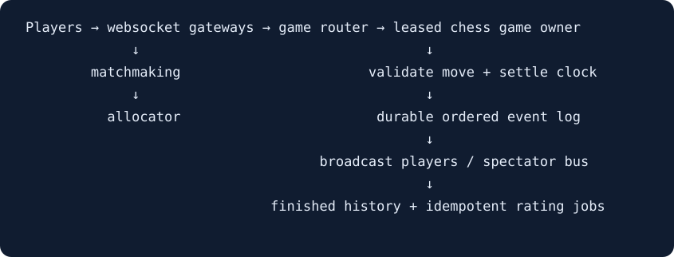

# W516. Design an Online Chess Platform (Matchmaking, Live Games, Clocks)

**Priority group:** Final 47 — complete coverage

**Category:** Games, simulations and object design

**Study position:** 516 of 547

[Group list](../FINAL_47.md) · [All categories](../ALL_CATEGORIES.md) · [Chapter guide](../README.md)

<span class="practice-page"></span>

## Question

Design an online chess platform. Two people anywhere in the world should be able to find an opponent of similar strength, play a timed game in real time, and review the game afterwards. The service must be fair: the server decides which moves are legal and whose clock has run out, even when a player's network is slow or drops.

### Requirements

1. Accounts and ratings. Every player has a rating per time control (for example bullet, blitz, rapid) that changes after each rated game.
2. Matchmaking. A player picks a time control (for example 3 minutes + 2 seconds per move) and joins a queue. The system pairs players of similar rating quickly; a player who has waited longer may accept a wider rating gap. Players can also challenge a specific friend.
3. Real-time play. Each move reaches the opponent with low latency. The server is the authority: it validates every move against the rules of chess and rejects illegal or out-of-turn moves. Resign, draw offers, draw by repetition or insufficient material, checkmate and stalemate end the game.
4. Clocks. Each side has a chess clock with an optional increment. A player whose time runs out loses (unless the opponent cannot mate). Clock decisions must be fair to players with slow networks and must not trust the client.
5. Disconnects. A player who drops can reconnect to the same game and see the current position and clocks.
6. Game history. Finished games are stored with every move and its clock time, can be replayed move by move, and are listed on each player's profile.
What to deliver
1. Capacity estimates: connections, messages per second and storage.
2. The API and the real-time protocol between client and server.
3. The main components and how a game is routed to the server that owns it.
4. The data model for players, ratings, live games and finished games.
5. The matchmaking algorithm.
6. How clocks are kept fair and authoritative.
7. Failure handling: a game server crashes, a client reconnects, a move request is retried.

### Examples

Immediate pairing. Two players rated 1500 and 1540 both join the 3+2 queue at the same moment; with a starting window of 50 rating points their 40-point gap fits, so they are paired at once.
Widening window. A 1800 player and a 1650 player join the same queue at the same moment, 150 points apart. With the window growing 25 points per second from 50, each window reaches 150 after 4 seconds, and only then are they paired.
Clock with increment. In a 3+2 game white starts with 180,000 ms. After white spends 4 s, black 10 s, white 30 s and black 1 s, white has 150,000 ms left and black has 173,000 ms: each move charges the time spent and then adds 2 s.
Scale assumptions

```text
500,000 concurrent players at peak, so 250,000 games in progress.
```

On average one move per game every 5 seconds.

```text
10 million finished games per day, kept forever.
```

Move delivery under 200 ms p99 between players on the same continent.
Follow-up 1: spectators for popular games

Anyone can watch a live game, and popular games may have very many viewers. How are moves delivered to spectators without overloading the server that owns the game?

## Worked solution

### One ordered authority per game

Use HTTPS for accounts/history and WebSocket for player commands/events. Matchmaking partitions by time control, mode and region/latency policy, then indexes rating and wait age. Choose a game owner by game ID and keep its lease/epoch in a routing directory; gateways forward commands to that owner. A reconnect is routed by game ID, not whichever backend happens to accept the new socket.



[Open the architecture diagram](../diagrams/W516_review_architecture.svg).

### API and state model

`POST /queue` creates an idempotent ticket; `DELETE /queue/{id}` cancels. A friend challenge creates a separately authorized invitation. Send moves as `{game_id,command_id,expected_ply,move}`. The server returns `{event_seq,position,remaining_white,remaining_black,server_time,status}`. Clients acknowledge/reconnect with the last sequence and can request a complete snapshot.

Store players, ratings keyed by `(player,time_control)`, live-game ownership/snapshots, append-only moves with clock values, and a final result/PGN reference. Use a complete chess rules engine for castling, promotion, en passant, repetition, draw rules and mate/stalemate; a piece-motion check is insufficient. A duplicate command ID returns its original outcome, and expected ply rejects stale/out-of-turn commands.

### Keep the clock authoritative

The owner tracks each remaining duration and the monotonic time at which the active turn began. At trusted server receipt/ordering of a legal move, subtract elapsed time, reject a flag fall under the agreed rules, then add increment and start the opponent's clock. A timer/deadline heap handles flag checks; no per-millisecond database write is needed. A move and timeout must be ordered by the same authority so both cannot win a race.

For the example, white has $180-4+2-30+2=150$ seconds and black $180-10+2-1+2=173$. Clients interpolate display from server snapshots but cannot set elapsed time with their timestamps. Network latency cannot be perfectly distinguished from deliberate waiting; define a bounded server-measured lag policy, if any, and apply it consistently. Do not grant unbounded time from claimed client lag. Timeout outcomes must check whether the opponent can mate under the chosen chess rules.

### Queue behavior and capacity

A window $50+25t$ rating points reaches 150 after four seconds, matching the example; use the required acceptance rule for both players, preserve oldest-first fairness and cap unacceptable mismatches. Pairing reserves both tickets atomically.

Five hundred thousand player connections imply 250,000 live games. One move per game per five seconds gives **50,000 incoming moves/s** and about **100,000 player move deliveries/s** when echoing each event to both players, before ACKs, spectators and clock updates. Do not broadcast clocks every millisecond. At an illustrative eighty plies and 32 bytes/ply, ten million finished games/day need 25.6 GB/day just for compact moves, about 9.34 TB/year before metadata, indexes, replication and backups. “Forever” requires ongoing tiered archival planning; actual PGN size should be measured.

### Recovery and popular spectators

Persist accepted moves durably before acknowledging a durable guarantee. An in-memory-only move followed by asynchronous persistence can be lost on crash; if that trade-off is chosen, state it explicitly. A replacement owner replays events/checkpoint under a new fenced epoch. Monotonic process timestamps are not portable, so persist clock durations plus a trusted recovery anchor and define whether outage time pauses the game; do not blindly reuse another process's monotonic value.

Finalization and rating application use unique game-result keys and transactional per-player ordering/version checks. Reconnects get position, event sequence and clock state; retried moves cannot charge clocks twice. Spectator fan-out subscribes to one game event stream through regional caches/gateways, isolating the owner from viewer count. Add bounded buffers/replay, optional spectator delay and backpressure. Load-test the 200 ms same-continent p99 target, owner failover, duplicate commands and lost connections.
