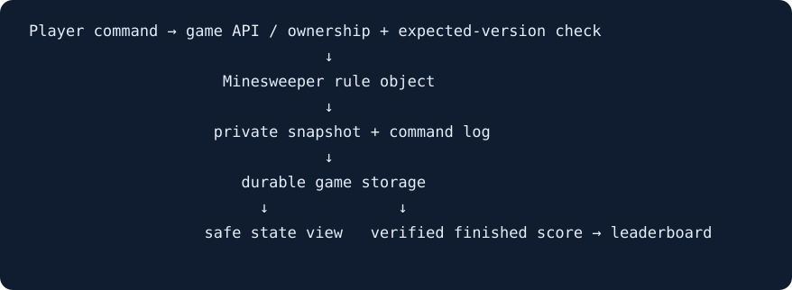

# W517. Minesweeper Game Design (OOD)

**Priority group:** Final 47 — complete coverage

**Category:** Games, simulations and object design

**Study position:** 517 of 547

[Group list](../FINAL_47.md) · [All categories](../ALL_CATEGORIES.md) · [Chapter guide](../README.md)

<span class="practice-page"></span>

## Question

A candidate-chosen game design round ('design the game you enjoy') — implement Minesweeper as OOD plus a touch of system design for multi-user / persistence.

Core game: variable board size and mine count, flood-fill reveal, flag mode, win/lose detection.

API: newGame(rows, cols, mines), reveal(r, c), flag(r, c), getState().

Also discuss persistence (resume an in-progress game), a high-score leaderboard, and multi-device sync.

## Worked solution

### Give the board one owner of its rules

The `Minesweeper` object owns board dimensions, mine locations, revealed cells, flags, status and version. A cell's neighboring-mine count is derived from the immutable mine layout. A reveal of an empty cell performs breadth-first flood fill, expanding only through zero-count cells while also revealing their numbered boundary. Flags do not establish a win; revealing all non-mine cells does.



[Open the architecture diagram](../diagrams/W517_review_architecture.svg).

### Runnable model

[Download the implementation and checks](../minesweeper_517.py).

```python
"""W517 local model; API state never exposes unrevealed mines."""

from collections import deque
import random


class Minesweeper:
    def __init__(self, rows, cols, mines, seed=0):
        if rows < 1 or cols < 1 or not 0 <= mines < rows * cols:
            raise ValueError("Need a nonempty board with at least one safe cell")
        self.rows = rows
        self.cols = cols
        self.mines = set(random.Random(seed).sample(range(rows * cols), mines))
        self.revealed = set()
        self.flagged = set()
        self.status = "playing"
        self.version = 0

    @classmethod
    def newGame(cls, rows, cols, mines, seed=0):
        return cls(rows, cols, mines, seed)

    def _index(self, r, c):
        if not 0 <= r < self.rows or not 0 <= c < self.cols:
            raise ValueError("Out of bounds")
        return r * self.cols + c

    def _neighbors(self, index):
        r, c = divmod(index, self.cols)
        for dr in (-1, 0, 1):
            for dc in (-1, 0, 1):
                if (dr or dc) and 0 <= r + dr < self.rows and 0 <= c + dc < self.cols:
                    yield (r + dr) * self.cols + c + dc

    def _count(self, index):
        return sum(n in self.mines for n in self._neighbors(index))

    def flag(self, r, c):
        index = self._index(r, c)
        if self.status != "playing" or index in self.revealed:
            return self.getState()
        if index in self.flagged:
            self.flagged.remove(index)
        else:
            self.flagged.add(index)
        self.version += 1
        return self.getState()

    def reveal(self, r, c):
        index = self._index(r, c)
        if self.status != "playing" or index in self.flagged or index in self.revealed:
            return self.getState()
        if index in self.mines:
            self.revealed.add(index)
            self.status = "lost"
        else:
            queue = deque([index])
            while queue:
                current = queue.popleft()
                if (
                    current in self.revealed
                    or current in self.flagged
                    or current in self.mines
                ):
                    continue
                self.revealed.add(current)
                if self._count(current) == 0:
                    queue.extend(self._neighbors(current))
            if len(self.revealed) == self.rows * self.cols - len(self.mines):
                self.status = "won"
        self.version += 1
        return self.getState()

    def getState(self):
        board = []
        for r in range(self.rows):
            row = []
            for c in range(self.cols):
                index = r * self.cols + c
                row.append(
                    "*"
                    if index in self.revealed and index in self.mines
                    else (
                        self._count(index)
                        if index in self.revealed
                        else "F" if index in self.flagged else "."
                    )
                )
            board.append(row)
        return dict(board=board, status=self.status, version=self.version)

    def snapshot(self):
        # Private persistence representation; never return this to a player.
        return dict(
            rows=self.rows,
            cols=self.cols,
            mines=sorted(self.mines),
            revealed=sorted(self.revealed),
            flagged=sorted(self.flagged),
            status=self.status,
            version=self.version,
        )

    @classmethod
    def restore(cls, snapshot):
        game = cls(snapshot["rows"], snapshot["cols"], 0)
        game.mines = set(snapshot["mines"])
        game.revealed = set(snapshot["revealed"])
        game.flagged = set(snapshot["flagged"])
        game.status = snapshot["status"]
        game.version = snapshot["version"]
        return game


if __name__ == "__main__":
    empty = Minesweeper(3, 3, 0)
    assert empty.reveal(1, 1)["status"] == "won"
    game = Minesweeper(2, 2, 1)
    mine = next(iter(game.mines))
    r, c = divmod(mine, 2)
    game.flag(r, c)
    before = game.version
    game.reveal(r, c)
    assert game.version == before
    game.flag(r, c)
    assert game.reveal(r, c)["status"] == "lost"
    assert Minesweeper.restore(game.snapshot()).getState() == game.getState()
    safe = Minesweeper(3, 3, 1)
    for cell in set(range(9)) - safe.mines:
        safe.reveal(*divmod(cell, 3))
    assert safe.status == "won"
    assert "*" not in str(Minesweeper(2, 2, 1).getState())
    print("W517 flood-fill, flags, loss, win, snapshot and hidden-state checks passed")
```

`newGame` returns a game instance, and the remaining methods act on it. This API chooses toggle semantics for `flag`. Revealing flagged/already revealed cells and commands after completion are no-ops. It allows a mine on the first click; if a guaranteed-safe first click is required, place mines after that click while excluding the chosen cell (and optionally its neighbors). That changes generation, not flood-fill rules.

Worst-case reveal work is linear in board size. Each cell has at most eight neighbors; revisits are skipped. A queue avoids recursive stack overflow on large empty boards. The seed is for repeatable tests, not a public competitive-board secret.

### Persistence, scores and multi-device synchronization

Store the **private** snapshot, owner, rules/version, server start/finish times and an append-only command ID log. The public `getState` deliberately excludes hidden mines. Do not let an HTTP serializer accidentally expose `snapshot`; mine locations and seeds defeat the puzzle.

For multi-device use, submit `{game_id,command_id,expected_version,action}`. Serialize commands per game using an owner or transactional compare-and-swap. Deduplicate command IDs, especially because retrying a flag toggle twice would undo it. Persist state/version before acknowledging; broadcast the new safe view or delta. A stale device receives the latest version and must reapply an intentional action rather than overwriting the whole board.

Leaderboard entries come from server-validated completed games and trusted elapsed time, keyed by unique game ID so replay cannot add another score. Partition rankings by board/rules/difficulty; different boards are not automatically comparable. Apply rate limits and integrity checks before accepting competitive scores. The local tests cover zero-mine flood fill, flag protection/toggle, loss, safe-cell win and snapshot restoration; concurrent API persistence requires integration tests in the chosen backend.
