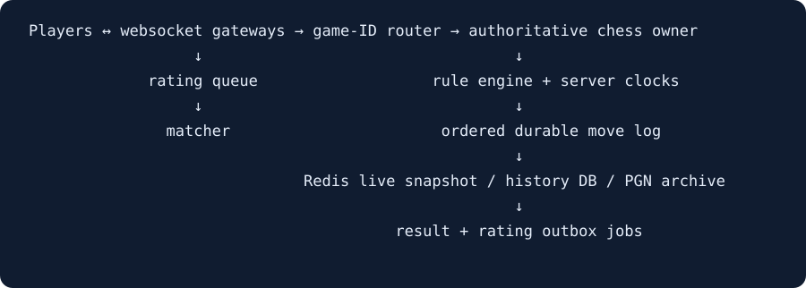

# W518. System Design: Chess Game

**Priority group:** Final 47 — complete coverage

**Category:** Games, simulations and object design

**Study position:** 518 of 547

[Group list](../FINAL_47.md) · [All categories](../ALL_CATEGORIES.md) · [Chapter guide](../README.md)

## Question

Design Chess.com (Online Chess Game)
Problem Statement

Design the backend system for an online chess platform supporting real-time play similar to Chess.com. The system must handle matchmaking, real-time move processing, and accurate clock management.

### Requirements

Functional Requirements
Players can create accounts and have Elo ratings
Players can join a matchmaking queue and be paired with an opponent
Matched players play a game in real time (both players connected via WebSocket)
Each move is validated server-side before being applied
Each player has a clock (e.g., 10 min blitz); the server is the authoritative clock
Games end on checkmate, draw, resignation, or timeout
Game history is persisted and viewable later
Non-Functional Requirements
Latency: Move processing &lt; 100ms round-trip
Scale: 1M DAU, 100K concurrent games
Correctness: Authoritative server-side clock; no client clock manipulation
Durability: Complete game history stored permanently
Design Areas to Cover
1. Matchmaking — How to pair players by Elo rating quickly
2. Game Session — How a game state is stored and updated
3. Move Processing — How to validate and apply moves server-side
4. Clock Synchronization — How to handle authoritative clocks fairly
5. Real-time Communication — WebSocket architecture for move delivery
6. Game Persistence — Storing move history (PGN format)
7. Scaling — How to horizontally scale game servers

### Examples

Player A (1500 Elo) joins queue
Player B (1520 Elo) joins queue → matched (within 50 Elo)

Game starts:
Server creates game_id, assigns White=A, Black=B
Both players connect via WebSocket to game_server_X
A makes move e2-e4:
Server validates (legal move, A's turn, A's clock running)
Server applies move to board state
Server stops A's clock, starts B's clock
Server broadcasts [move + new clock values] to both players
B responds...
Game ends: Server records result, updates Elo ratings
Evaluation Criteria
Elo-based matchmaking with acceptable wait-time trade-offs
Authoritative server-side clock (not trusted client timestamps)
Move validation engine (chess rules implemented or delegated to library)
Game state stored in fast in-memory store (Redis) with async persistence to DB
WebSocket sticky sessions or routing for game servers

## Worked solution

### Separate a live game's authority from connection handling

At 100,000 concurrent games, expect about 200,000 player WebSocket connections before spectators. A gateway accepts/authenticates sockets; a directory maps game ID to a leased game owner. The owner serializes move and timeout decisions for that game. Scaling gateways and game workers separately avoids tying game authority to a player's original TCP connection.

[Open the architecture diagram](../diagrams/W518_review_architecture.svg).

### Matchmaking and move processing

Queue by time control/mode and allowed region, indexed by Elo and enqueue age. Begin with a fifty-point window and widen it with wait time up to a cap; reserve both tickets atomically. Allocate a game ID/owner, assign colors and issue scoped session tokens. Friend challenges use the same game creation path after explicit acceptance.

A command includes game ID, player identity, unique command ID, expected ply and move. Validate identity, turn, current position, legal move and clock before applying it. Use a complete chess library for special moves and terminal/draw rules. Persist a unique ordered event with move, resulting state hash and both clocks; then acknowledge/broadcast. Duplicate command IDs return the earlier result and cannot move a piece or charge time twice.

### Clock semantics

Keep remaining durations and a monotonic turn-start time in the active owner. When an authoritative ingress time is accepted, subtract elapsed time, determine flag fall, then add any increment and start the other clock. Clients render an estimate from server values; never trust their wall-clock timestamps. Order a move and timeout through the same authority. A bounded server-measured lag-compensation policy may improve fairness but cannot perfectly recover unknowable one-way network delay.

For a crash, acquire a new fenced lease, replay durable events and restore clock durations using a documented pause/recovery policy and trusted time anchor. Process-local monotonic timestamps cannot be reused on another host. A simple Redis snapshot plus **asynchronous-only** DB writes can lose acknowledged moves; either durably log before ACK or explicitly accept that recovery risk. An in-memory store does not provide the permanent-history guarantee on its own.

### Storage, capacity and failure behavior

Store players, per-time-control ratings, queue tickets, live ownership/snapshots, append-only moves, finalized result and PGN. Apply rating updates through an idempotent result event with unique `(game_id,player_id)` keys and concurrency-safe player-rating versions. Archive finished PGN durably and index player/game metadata for history queries.

The prompt gives concurrency and DAU but not move frequency or game duration. Under an illustrative one move per game per five seconds, ingest 20,000 moves/s and broadcast roughly 40,000 player events/s, before spectators/ACKs. Size storage from measured bytes/game and finished games/day, not DAU alone. Partition workers by game ID, keep capacity headroom, and route reconnects to the existing game. Replay from a sequence or return a complete position/clock snapshot.

Test lost ACKs, duplicate/out-of-order moves, simultaneous resign/move/timeout, owner loss and replica lag. Move processing under 100 ms RTT needs nearby players/servers and measured end-to-end tails; globally distant opponents cannot be guaranteed that physical RTT. Spectator fan-out belongs on a replicated pub/sub path with replay/backpressure so a popular game does not overload its authoritative worker.
