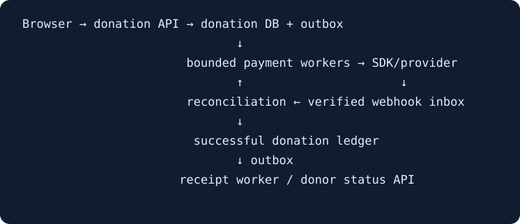

# W519. Charity Donation System

**Priority group:** Final 47 — complete coverage

**Category:** Payments, ledgers and billing

**Study position:** 519 of 547

[Group list](../FINAL_47.md) · [All categories](../ALL_CATEGORIES.md) · [Chapter guide](../README.md)

## Question

Design a charity donation website where payment execution is abstracted behind an SDK, but the system still has to handle correctness, failure recovery, duplicate prevention, and traffic spikes.

### Requirements

Let users browse or select a charity and submit a donation amount.
Use a payment SDK or external payment abstraction for actual charge execution.
Record donation intent, payment result, and receipt state durably.
Prevent lost donations, duplicate charges, and incorrect donation amounts.
Handle payment failure, timeout, retry, and callback/webhook mismatch.
Support traffic spikes, such as a campaign or viral event causing sudden donation volume.
Provide operational visibility for failed or pending donations.
Notes
Core design decision: store the donation intent before calling the SDK, then make SDK calls idempotent with a donation/payment idempotency key.
Treat payment callbacks as asynchronous and potentially duplicated. The state machine should tolerate pending -&gt; succeeded, pending -&gt; failed, retries, and late callbacks.
Store raw provider events and process them through an idempotent event table keyed by provider event id; callbacks should update state only through allowed transitions.
Validate amount, currency, charity id, and donor id both before creating the payment attempt and when reconciling provider callbacks.
Discuss queueing/backpressure for traffic spikes, plus rate limits to the external payment provider.
Interviewers have focused on failure scenarios: avoiding donation loss, avoiding amount mismatch, and handling provider failure.

## Worked solution

### Persist intent before attempting a charge

A donation has a stable internal ID, donor, charity, immutable amount in integer minor units, currency, payment-attempt state and receipt state. Create that intent before calling the payment SDK. A network timeout after a charge may mean the charge succeeded, so “catch exception and start another payment” is unsafe.

[Open the architecture diagram](../diagrams/W519_review_architecture.svg).

### API and state machine

`POST /donations` accepts a client idempotency key plus charity/amount/currency. Authenticate the donor, validate the charity and amount limits, and store the key with a request hash. Repeating the same request returns the same donation; reusing a key for different fields is a conflict. Use decimal-to-minor-unit conversion with currency rules rather than floating-point money.

States include CREATED, PAYMENT_PENDING, SUCCEEDED and FAILED, with a separate UNKNOWN/pending-reconciliation state when outcome is uncertain. An SDK attempt uses a stable provider idempotency key derived from donation/attempt ID. Duplicate delivery of the outbox job therefore cannot create a second charge, assuming the provider honors the key for the required retry period. Without provider idempotency/status lookup, exactly-one external charge cannot be guaranteed by local storage alone.

### Callbacks and reconciliation

Verify webhook signatures and persist each raw provider event under a unique provider-event ID before processing it. Validate provider account, payment ID, amount, currency and donation binding. Apply only allowed transitions under a transaction/version check. A late success must reconcile an uncertain pending attempt; an old failure must not overwrite a confirmed success. Never trust arbitrary callback metadata as the source of the donation amount.

Use provider status queries and settlement reconciliation for missing/out-of-order callbacks or responses that disagree. A failed attempt can be retried under an explicit attempt policy only after its outcome is known, preserving the user's single donation intent. Keep an auditable mapping from every attempt to provider transactions.

### Spikes, receipts and operations

Serve charity browsing through caches/CDN. Queue payment work with provider-aware concurrency/rate limits, backpressure and bounded retries. Return an accepted donation ID and pending UI immediately; show paid confirmation only on confirmed success. A receipt outbox event is created transactionally with success and deduplicated by donation ID so a mail failure does not recharge the donor.

Monitor pending age, unknown outcomes, provider errors, amount mismatches, duplicate rejections, webhook lag and receipt failures. Provide an operations queue with safe reconcile/retry actions rather than editing money states manually. Test double taps, crash before/after SDK execution, timeout with later success, duplicate webhooks, wrong amounts and provider outage. The ledger and audit history must explain every accepted intent, not just successful charges.
