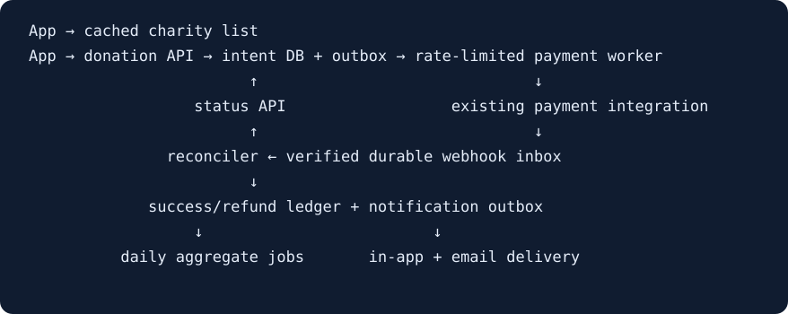

# W520. Design a 3-Day Donation Service

**Priority group:** Final 47 — complete coverage

**Category:** Payments, ledgers and billing

**Study position:** 520 of 547

[Group list](../FINAL_47.md) · [All categories](../ALL_CATEGORIES.md) · [Chapter guide](../README.md)

## Question

Design a donation service for a 3-day charity event inside the DoorDash app. Users browse a curated list of charities, donate a custom amount via the existing DoorDash payment integration (a Stripe-equivalent third party), and receive in-app + email confirmation. Charities see aggregated daily totals; refunds are supported.

Non-functional: bursty load (10k+ donations/min at peak after a push, ~1k/min sustained); payment correctness is a hard requirement (exactly one charge per donation intent even on double-tap or dropped network); sub-second perceived confirmation latency (actual charge can complete async); daily aggregates may lag a few minutes.

## Worked solution

### Use a durable asynchronous donation flow

The three-day event needs a fast **accepted/pending** experience, not a fabricated sub-second payment settlement. Show “Donation submitted” with status tracking quickly, then confirm only when the existing payment integration reports success. At 10,000 donations/min peak, intake is about 166.7/s; 1,000/min sustained is 16.7/s. Provision for larger push bursts and the provider's actual quotas. Three days at the stated sustained rate would be 4.32 million intents, but peak duty cycle is unspecified.

[Open the architecture diagram](../diagrams/W520_review_architecture.svg).

### Correctness from intent through refunds

`POST /events/{event_id}/donations` takes charity, amount/currency and a client-generated idempotency key preserved across double taps/reconnects. Store immutable integer minor-unit amounts and validate the event window/charity eligibility. A repeated key with a different request body is rejected. Persist intent and outbox in a transaction, then send a stable payment idempotency key to the existing integration. Keep attempt IDs distinct from the one logical donation.

The state machine distinguishes accepted, pending/unknown, succeeded and failed. Verify webhook authenticity and amount/currency/intent linkage, store unique raw provider-event IDs and apply ordered legal transitions transactionally. A timeout triggers status lookup/reconciliation rather than a fresh blind charge. Exactly one charge depends on the payment integration honoring idempotency across the needed retry window; document that dependency and reconcile settlement reports for gaps.

Refunds have their own immutable operation IDs, amounts and provider idempotency keys. In a transaction, reserve refundable value so concurrent refunds cannot exceed the settled amount. Record pending/succeeded/failed refunds as ledger entries rather than overwriting the original donation. Late callbacks settle the matching operation once.

### Notifications, totals and campaign end

Create notification events in the same transaction as confirmed success/refund. Deduplicate in-app messages and email jobs; failed email delivery is not a payment failure. Keep personal donor details out of charity aggregates. Compute daily totals from ledger entries grouped by event, charity, currency and an explicitly chosen timezone. Report gross donations, refunds and net separately; never sum different currencies without a defined conversion policy. Idempotent stream/materialized-view updates or periodic recomputation can meet a few-minutes lag target.

Limit payment-worker concurrency to provider capacity, buffer within an explicit pending-time SLA, and communicate delays honestly. The three-day intake window does not mean turning the service off: retain payment/refund/webhook processing, receipts, reconciliation and support for the required period afterward. Define late in-flight submissions at the cutoff and ensure retries do not create new donations after the event closes.

Monitor accepted-to-confirmed latency, unknown/pending age, provider/webhook failures, ledger-versus-provider reconciliation, aggregate lag and notification backlog. Load-test the push spike and duplicate-submit races; fault-test crashes around provider calls, missing callbacks, partial refunds and post-event recovery. Keep audit logs and access-controlled operations tools so every accepted intent can be resolved.
