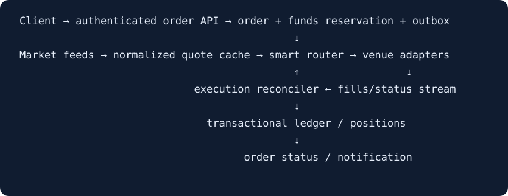

# W531. Design a Crypto Brokerage Order System

**Priority group:** Final 47 — complete coverage

**Category:** Trading and financial systems

**Study position:** 531 of 547

[Group list](../FINAL_47.md) · [All categories](../ALL_CATEGORIES.md) · [Chapter guide](../README.md)

## Question

Design the trading flow of a crypto brokerage (e.g., Coinbase). A user submits a buy/sell market order; the platform quotes prices across multiple external matching venues (Binance, Kraken), routes to the best price, updates balances/positions atomically, and shows confirmation in seconds.

### Requirements

Consistency: no double orders, no lost orders (money is involved).
Availability: ~99.9% uptime.
Latency: get prices &lt; 500ms, place orders &lt; 1s.
Fault tolerance: third-party exchange APIs are slow/async and often fail.
Scale: 10M users; ~0.6 TPS average, design for 1,000+ TPS spikes (market crashes can be 1000x).

Focus the discussion on the order lifecycle (state machine), idempotency under network retries, balance accounting, and integration with async third-party matching engines.

## Worked solution

### Make acceptance durable and execution asynchronous

A user submits an order intent, not a guaranteed completed trade. Persist it before contacting a venue and return its stable ID. The quoted targets—prices within 500 ms and placement within one second—can be targets for quote/acceptance or downstream acknowledgement; they cannot force an unavailable external venue to fill. Clarify market/slippage limits, asset units, custody and venue pre-funding.

[Open the architecture diagram](../diagrams/W531_review_architecture.svg).

### State machine and money

Use CREATED/RESERVED → SUBMITTING → ACKNOWLEDGED → PARTIALLY_FILLED → FILLED, with REJECTED, CANCEL_PENDING and CANCELLED paths. UNKNOWN is an operational uncertainty state after a timeout; it does not mean the order failed. Retain each child venue order and execution ID. A client idempotency key plus request hash ensures a retry cannot change side/size or create another parent order.

Reserve buying power or sellable asset under a transaction/lock on the account. Store integer base/quote asset units or exact decimals with explicit precision, never floating-point money. A fill transaction inserts a unique execution ID, consumes/reduces reservation, updates cash/asset ledger entries, records fees and advances cumulative order quantity atomically. Enforce nonnegative available balance and quantity conservation. Do not pretend an external exchange action and local SQL commit form one atomic transaction; the durable state machine and reconciliation bridge them.

### Best executable price and failure recovery

Normalize bid/ask, timestamp, depth, fees, venue health and currency. For a buy, compare available **ask** liquidity plus fees/slippage; for a sell, compare **bid** proceeds. A single top price may not cover the whole size. Bound quote age, enforce a user-approved slippage limit and reserve enough for the worst permitted cost. Simultaneous venue orders require nonoverlapping quantity allocations to avoid overfill.

Send a stable venue client-order ID/idempotency key and query by that ID after an uncertain response. Retry the same operation only when the venue contract makes it safe. If a venue offers neither idempotency nor lookup, the system cannot guarantee no duplicate external orders after an ambiguous timeout; require that contract or stop/reconcile manually. Deduplicate fills, accept out-of-order statuses without regressing cumulative execution, and reconcile venue statements/open orders with local records.

### Capacity, availability and tests

Design the burst path for at least 1,000 TPS, not the 0.6 TPS average. Queue routing work, enforce account/venue limits and retain headroom during market spikes. Cache quotes from pushed feeds rather than querying every venue serially for every user. Keep multiple API/worker replicas and replicated durable stores, while fencing account/child-order writers to prevent split-brain execution. 99.9% service uptime is distinct from venue availability or execution success.

Test duplicate submits, simultaneous orders spending one balance, crash before/after venue submission, partial fills followed by cancellation, duplicate executions, stale quotes and exchange outages. Monitor unacknowledged age, reconciliation differences, reserved funds, fill latency, venue errors and quote freshness. Users see pending/partial/confirmed states derived from the ledger rather than optimistic “bought” messages from an SDK return alone.
