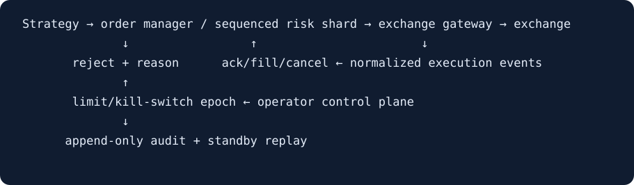

# W532. Design Pre-Trade Risk Checking for an Electronic Trading System

**Priority group:** Final 47 — complete coverage

**Category:** Trading and financial systems

**Study position:** 532 of 547

[Group list](../FINAL_47.md) · [All categories](../ALL_CATEGORIES.md) · [Chapter guide](../README.md)

## Question

Design the pre-trade risk checking for an electronic trading system. Every order must be checked against risk limits before it is allowed to leave the building, and an order that breaches a limit must be stopped.

The system

Orders travel through three stages on the way to the exchange, and responses travel back:

new order
passed
order
ack, fill, cancel
ack, fill, cancel
reject
ack, fill, cancel
Strategy
Order Manager
Exchange Gateway
Exchange
1. A trading strategy sends a new order to the order manager.
2. The order manager runs the risk checks. An order that passes goes on to the exchange gateway, which talks to the exchange.
3. An order that breaches a risk limit is rejected: it never reaches the exchange, and the rejection returns to the strategy with a reason.
4. The exchange answers with acknowledgements, fills and cancels, which return through the gateway and the order manager to the strategy.
Assumptions to design against

State and use these figures (or adjust them and say so):
1. Up to 1,000 strategies trading up to 5,000 symbols, with 200,000 orders per second at the daily peak and about 20,000 orders per second on average over a 6.5-hour session.
2. The risk check must add no more than 50 microseconds at the 99th percentile to an order's path.
3. Limits to enforce include a per-strategy order rate, a price band around a reference price, a maximum order size and notional, a maximum position per strategy and symbol, and a firm-wide cap on gross exposure.
4. Limits change during the day, and operators must be able to stop trading quickly.
Required in your answer
1. The components and the interface between each pair of them.
2. How an order is checked, how state is kept up to date from fills and cancels, and what happens on a reject.
3. How you keep the check correct when orders, fills and cancels race each other.
4. How you meet the latency budget and scale beyond one machine.
5. How you test the risk logic, and how you operate it: limit changes, a kill switch, monitoring, failover and an audit trail.
What the answer is judged on

The design is weighed on correctness, performance, testability and operability, so say how each is achieved and where you traded one for another.

## Worked solution

### The gateway must never bypass the risk gate

Define a compact order interface with strategy/account, symbol, side, quantity, price, client order ID and limit-version metadata. Gateway events carry stable order/execution IDs, cumulative filled quantity, remaining quantity and lifecycle sequence. The order manager owns risk reservations and rejects with a structured reason before forwarding any failing order.

[Open the architecture diagram](../diagrams/W532_review_architecture.svg).

### Check and reserve in one serialization order

Run rate/size/notional/price-band checks against versioned, fresh reference data. Reject stale/unavailable reference prices according to policy. Use exact fixed-point arithmetic with overflow checks. A token bucket handles per-strategy rates; define whether rejects consume rate tokens so an abusive rejected stream cannot evade protection.

For strategy-symbol position q, outstanding buy quantity B and outstanding sell quantity S, the reachable position interval is $[q-S,q+B]$. Require that both ends fit permitted position bounds. A new buy must reserve its quantity/notional **before** forwarding, so two concurrent buys cannot both pass using the same headroom. On a fill, advance q and reduce that order's remaining reservation atomically. Keep reservations for a cancel request until cancellation is acknowledged or final exchange state is reconciled: a fill may win the race.

Deduplicate execution IDs and use cumulative filled quantity/monotonic lifecycle rules to handle duplicates and out-of-order events. A late fill after cancel can be legitimate for the previously executed quantity; reconcile it rather than discarding all events after the word “cancelled.” Release only proven remaining exposure. Reject paths must not leave a phantom reservation; uncertain sends retain it until reconciled.

### Scale within fifty microseconds

At 200,000 orders/s peak, one arrival occurs every five microseconds globally; average session volume is $20{,}000\times6.5\times3{,}600=468$ million orders. Keep hot state in memory, use preallocated bounded structures, single-writer/sharded processing, pinned workers and no remote database/metrics RPC in the synchronous check. Benchmark p99 with real event mixes, burst queues and reference updates; an average arithmetic benchmark does not establish fifty-microsecond tail latency.

Shard by strategy/account while preserving a single order for its risk state. The firm-wide gross limit cannot be enforced by unrelated eventually consistent counters. One approach allocates conservative exposure credits to shards; their total never exceeds the firm cap, and each shard reserves locally within its credit. Rebalancing credits is coordinated off the hot path. Mark-to-market moves also consume headroom, so reserve conservative valuation buffers or synchronously reduce permitted trading when the exposure bound is breached. A central sequencer is simpler for strict global accounting but adds throughput/failover constraints. State the trade-off rather than promising cross-machine consensus inside every fifty-microsecond check.

### Operate and prove correctness

Apply limit changes as ordered versioned events. Lowering a limit below existing exposure blocks new risk and triggers a defined cancel/escalation policy; it cannot undo fills. A kill switch must reach both risk managers and gateways under a monotonically increasing epoch, with stale actors fenced. Failure must block unverified new risk rather than bypass checks.

Keep a durable audit of input/event IDs, limit/reference versions, decisions, reservations and operator changes. A fenced standby replays the same order; trading resumes only after reservation and exchange-state reconciliation. Use property/state-machine tests for no limit breach, no double release and quantity conservation, plus adversarial event permutations, overflow/stale-price tests and peak-latency benchmarks. Monitor reject reasons, queue age, outstanding reservations, credit usage, replication lag and kill-switch propagation without blocking the hot path.
