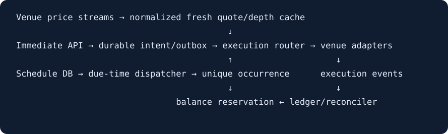

# W533. Low-Latency Multi-Exchange Buy/Sell System Design

**Priority group:** Final 47 — complete coverage

**Category:** Trading and financial systems

**Study position:** 533 of 547

[Group list](../FINAL_47.md) · [All categories](../ALL_CATEGORIES.md) · [Chapter guide](../README.md)

## Question

System Design Question

Design a buy and sell system that finds the lowest price for transactions across all exchange chains. This system should ensure low latency and support both real-time and scheduled transactions.

Start with designing APIs with a focus on latency and scheduling issues.
The system should quickly react to price changes to ensure that the best price is utilized in any transaction request.
During the design, consider error handling and scalability, making sure the system can accommodate traffic growth.
When implementing the scheduled transaction feature, ensure proper management and prioritization of scheduled requests.

Describe how you would design such a system and highlight key technical choices.

## Worked solution

### API first: separate a schedule from an execution

Use `POST /v1/orders` for immediate intent, `GET /v1/orders/{id}` for status and `POST /v1/schedules` for a future execution rule. A schedule includes asset/pair, side, amount, execute-at time or recurrence, timezone semantics, slippage/limit policy and idempotency key. Cancellation changes the schedule version; an already submitted child order requires its own cancellation workflow.

[Open the architecture diagram](../diagrams/W533_review_architecture.svg).

### Define “best” correctly

For a buy, minimize executable total cost; for a sell, maximize net proceeds. Include side-specific bid/ask depth, fees, currency conversion, venue health, quote age and expected slippage. If “exchange chains” means on-chain routes, include gas, settlement latency, liquidity and MEV/reorganization risks; if it means centralized venues, use their order/fill semantics. These are materially different execution contracts and must be clarified.

Maintain feeds in the background instead of polling all venues serially on the request path. Record quote IDs/timestamps and cap age. A quote is not a fill guarantee; enforce the user's approved worst price and reject/requote when it cannot be honored. Split orders only with coordinated quantity and balance reservations so several venues cannot spend the same funds.

### Scheduling and retries

Store schedules durably and partition due-time scanning/timing wheels by time buckets and shard. Claim an occurrence under a lease and unique `(schedule_id, occurrence_time, version)` key. That key prevents duplicate dispatch after crash; the actual venue operation also needs a stable client-order ID/idempotency contract. Reprice and recheck funds/risk at execution time rather than freezing today's quote for next week.

Reserve execution capacity for imminent deadlines and cancellation/reconciliation work, with fair per-user limits. Jitter internal wakeups where allowed, but do not silently shift user deadlines. When many schedules become due simultaneously, queue within explicit lateness limits or report a missed occurrence. Clock synchronization and monotonic local waits matter, while the durable schedule uses an agreed wall-time representation.

### Failure and scale

Use an order state machine with pending, acknowledged, partial, filled, cancelled/rejected and uncertain outcomes. A timeout does not authorize a second blind order; query/reconcile by the same venue ID. Deduplicate fills and settle a double-entry ledger transactionally. Provider outages trigger circuit breakers and route only to eligible venues with sufficient funds/liquidity. Bound retries and global queue growth.

Shard quote processing by venue/instrument and intents by account/order ownership, with replication and fenced failover. Monitor quote freshness, scheduled lateness, execution slippage, unknown orders, reconciliation differences and p99 acceptance/route time. No traffic or precise latency target is given, so state an assumed burst and benchmark each stage rather than asserting an unsupported capacity number.
