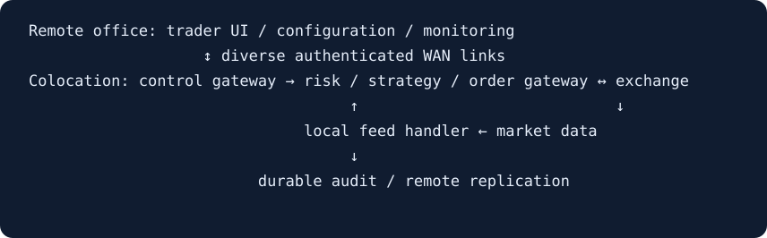

# W535. Low-Latency Trading System Design

**Priority group:** Final 47 — complete coverage

**Category:** Trading and financial systems

**Study position:** 535 of 547

[Group list](../FINAL_47.md) · [All categories](../ALL_CATEGORIES.md) · [Chapter guide](../README.md)

## Question

Low-Latency Trading System Design

An onsite/super-day system-design round (SWE intern loop): design a trading system given a colocated 'locker box' next to the exchange while your traders work in an office in another city. The discussion centers on the network/infrastructure between the two sites and leans heavily on TCP/IP knowledge.

### Requirements

Design a trading system where you have a locker box (colocated server cage) next to the exchange, while your traders operate from an office in a different city.
Address the infrastructure needed to connect the two: network wires/links, bandwidth and latency/speed, and server placement.
Expect heavy TCP/IP-level questioning throughout.
Notes
The round emphasizes low-latency networking trade-offs (colocation at the exchange vs. remote office, link bandwidth vs. latency, where to place compute) rather than a generic web-scale design.
Strong fundamentals in TCP/IP and how physical network constraints shape a trading architecture are the main signal; full prompt details beyond the colocation framing haven't been widely circulated.

## Worked solution

### Put the time-critical loop beside the exchange

A trader's desktop in another city is a control/monitoring endpoint. Put market-data decoding, strategy decisions where appropriate, pre-trade risk and order gateways in the colocated locker box. Otherwise each automated decision pays the intercity round trip, regardless of how fast the local CPU is.

[Open the architecture diagram](../diagrams/W535_review_architecture.svg).

### Explain the physical and protocol budget

Fiber propagation is roughly five microseconds per kilometer one way before route detours/equipment. For a 1,000 km physical path, the propagation floor is about five milliseconds one way and ten milliseconds round trip. More bandwidth cannot remove that floor. Serialization is $8S/R$: a 1,500-byte frame takes about 1.2 microseconds at 10 Gbit/s, while queueing, switches, NICs and the application add further delay. State actual cable length/hops rather than using city straight-line distance as a measured route.

Use exchange-approved cross-connects and protocols at colocation. Market data commonly uses sequenced UDP multicast with gap detection/replay; orders may use a reliable TCP-based exchange protocol. UDP avoids retransmission/head-of-line behavior but requires application recovery. TCP provides an ordered byte stream, not complete application messages or exactly-once orders. Define framing, handle partial reads/writes and distinguish an ACK of received bytes from acceptance of a trade.

### TCP/IP questions to defend

Keep connections established; handshakes/TLS setup do not belong on every order. Consider `TCP_NODELAY` for small latency-sensitive writes, batching trade-offs, socket buffer sizes, retransmission, congestion and packet loss. Disabling Nagle does not eliminate all buffering or network delay. A send timeout/disconnect leaves an order's application outcome uncertain; reconcile by stable client-order ID/session sequence before resending.

Separate the market-data/order hot path from UI traffic, logs and large deployments so one cannot fill another's queues. Use redundant physically diverse WAN paths, NICs/switches/power and controlled failover. Two logical circuits sharing one trench are not independent. Synchronize clocks for timestamp correlation with suitable hardware support; use monotonic elapsed measurements locally and distinguish clock error from network latency.

### Capacity and safe failure

Bandwidth depends on feed rates, burst size, subscriptions and recovery traffic, not the number of remote traders alone. For an illustrative one million 100-byte market messages/s, payload is 100 MB/s or 0.8 Gbit/s before framing and bursts. Measure peak packets/s as well as bytes/s; small-packet processing can be the bottleneck.

Failover must fence the former order sender so both links/servers do not duplicate execution. If the office disconnects, the colocated system follows an explicit risk/kill policy rather than relying on a human UI heartbeat to keep an uncontrolled strategy alive. Record order and market-data sequence gaps, round-trip distributions, packet drops, queue depths and time-sync health. Benchmark p99/p99.9 under realistic loss and bursts. The key trade-off is where decisions occur relative to physical distance; a generic load balancer/database diagram does not answer it.

### A useful follow-up distinction

This prompt has the same scope as W534. If asked to choose a faster link, compare propagation route, availability, jitter, packet loss and capacity separately. A shorter wireless route may reduce propagation delay while having weather/capacity constraints; it is not automatically the right link for every data/control flow. Quote an actual vendor/service measurement only when provided. The architecture above deliberately gives no fabricated intercity latency measurement.
