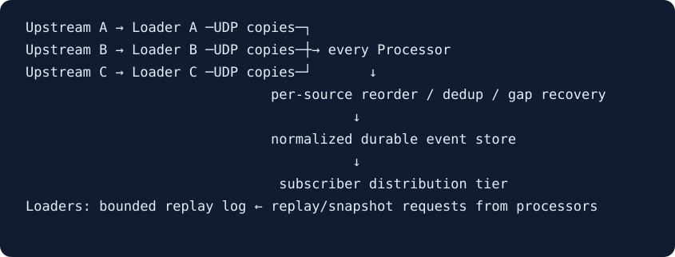

# W536. Real-time Market Data Distribution System

**Priority group:** Final 47 — complete coverage

**Category:** Trading and financial systems

**Study position:** 536 of 547

[Group list](../FINAL_47.md) · [All categories](../ALL_CATEGORIES.md) · [Chapter guide](../README.md)

## Question

Design a real-time market-data distribution system (Bloomberg domain-core onsite).

Functional requirements:

Multiple upstream exchanges (e.g. NASDAQ, NIFTY, S&P 500) send market-data messages to Loader servers.
Each Loader fans out several copies of every message over UDP to a set of Processor servers.
Every Processor must receive data from *all* Loaders, not just one.
Processors must cope with UDP realities: packet loss, duplicate delivery, and out-of-order arrival.
After processing and deduplication, persist the data and serve it to connected subscribers.

Non-functional / scale:

High-throughput, low-latency feeds; reason about per-exchange message rates and message sizes.
UDP is chosen for speed, so reliability must be rebuilt at the application layer.

## Worked solution

### Preserve all-loader delivery before optimizing

Every processor must receive every loader's stream. A normal load-balancing queue that sends each message to just one processor violates the prompt. Use each loader's multicast groups or explicit UDP destinations so all processors subscribe to all loader sources. Several redundant copies improve delivery probability but do not make UDP reliable.

[Open the architecture diagram](../diagrams/W536_review_architecture.svg).

### Give messages a meaningful identity

Include source/exchange channel, loader epoch, sequence, event time, schema version and payload. A loader sequence identifies duplicates from that loader; if several loaders duplicate the **same upstream feed**, use the upstream event/session sequence for cross-loader deduplication. Different exchanges can emit the same symbol/price legitimately, so `(symbol,price)` is not an event ID.

Processors maintain next expected sequence per source stream and a bounded reorder buffer. Equal/old sequence IDs are duplicates; future sequences indicate a gap. Buffer a bounded amount, request missing ranges over a reliable replay channel and continue only under an explicit policy. If replay retention is exhausted, request a versioned snapshot plus the sequence from which incremental replay resumes. Never silently treat the next received delta as a complete order book after loss.

### Persistence and downstream correctness

Partition durable data by source/instrument/time as query needs require, with uniqueness on event identity and a replayable processing offset. If every processor writes the same records, sink writes need deduplication or a designated/fenced writer; otherwise replication multiplies storage rows. Each processor may still independently validate all incoming sources as required. Choose whether subscribers need per-source or per-instrument ordering; there is generally no natural total order across independent exchanges.

Normalize clocks/units and preserve raw values and original timestamps. A named index is not necessarily itself an exchange/feed, so confirm the actual upstream contracts. Slow subscribers get bounded queues, snapshots/replay and explicit stale indicators; they cannot be allowed to block ingestion.

### Capacity and failure tests

If loader i receives $r_i$ events/s of size $s_i$ and sends c copies to each of P unicast processors, loader egress is $cP\sum_i r_is_i$ in aggregate, while each processor ingress is $c\sum_i r_is_i$. Multicast moves replication into the network but still consumes link/switch/receiver capacity. For three 100k/s feeds of 100 bytes, two copies and four processors, payload egress is 240 MB/s total with unicast, and each processor receives 60 MB/s before headers/bursts/recovery.

Test loss, duplicate copies, reordering beyond the buffer, loader restart/epoch reset, sequence wrap, snapshot/replay races and sink retry. Monitor per-source gaps, recovery lag, buffer pressure, stale books and end-to-end event latency. Correlated packet loss can defeat all redundant copies; the replay/snapshot contract is essential.
