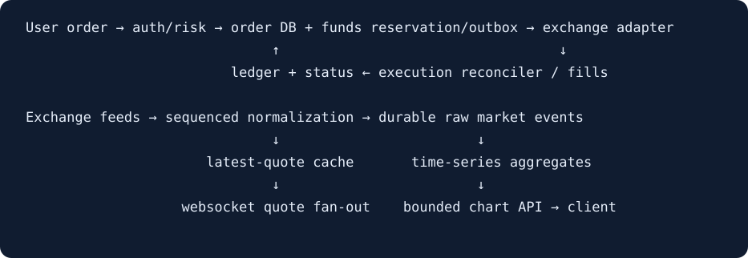

# W537. Stock Trading / Real-Time Quote System Design

**Priority group:** Final 47 — complete coverage

**Category:** Trading and financial systems

**Study position:** 537 of 547

[Group list](../FINAL_47.md) · [All categories](../ALL_CATEGORIES.md) · [Chapter guide](../README.md)

## Question

Stock Trading / Real-Time Quote System Design

Design Robinhood's core stock product: place buy/sell orders against an external exchange API and/or serve real-time quotes and historical price ranges. The second fixed system-design prompt alongside Job Scheduler.

### Requirements

Order placement: given an API to an external exchange, design a system that lets users place stock orders. Handle order lifecycle and reliability against the downstream exchange.
Real-time quotes + charts: users view the live price and historical ranges (past day / week / year). The number of returned data points must stay bounded regardless of range, and real-time prices must be served with fault tolerance.
Secure variant: design a secure Robinhood-style system on AWS, deep-diving user-profile management and stock query.

Key decision points the interviewer drills:

Storage for historical prices: a specialized time-series store vs. a background worker that pre-aggregates per granularity into a general DB.
Down-sampling so a 1-year view doesn't return excessive points.
Fault tolerance for the real-time price path.
Which database to use, and the trade-offs behind the choice.
Notes
Database/storage choice for the price history is a graded differentiator — candidates who hand-waved "background worker + general DB" without weighing a purpose-built time-series store flagged it as a likely red flag afterward.
Be ready to discuss different data granularities and how each range query is served efficiently.

## Worked solution

### Treat orders and market data as two related paths

The product needs both a money-correct order lifecycle and a bounded, fault-tolerant quote/history API. Sharing instrument IDs and user authentication does not mean serving charts through the order transaction database.

[Open the architecture diagram](../diagrams/W537_review_architecture.svg).

### Order lifecycle

`POST /v1/orders` takes a client idempotency key, side, instrument, exact quantity and order/slippage constraints. Persist intent and reserve buying power/position transactionally before sending to the exchange. Reusing a key with changed fields is a conflict. Track pending, acknowledged, partially filled, filled, cancel-pending, cancelled/rejected and uncertain states.

Use stable downstream client-order IDs and reconcile ambiguous timeouts rather than creating a new order. Deduplicate executions and atomically post cash/position/fee ledger entries with order progress. A cancel request is not a cancellation acknowledgement; fills can race it. The external exchange and local DB cannot share an ordinary atomic transaction, so recovery depends on durable state and the exchange's idempotency/status contract.

### Bound the chart query by construction

Offer `GET /prices/{symbol}?start=...&end=...&max_points=500`. Choose an aggregation interval at least $(end-start)/500$, round to a supported tier, and return at most the allowed number of buckets plus explicit metadata. For example, a day may use minute bars, a week hourly bars and a year daily bars, adjusted to the point cap and trading calendar. Return OHLCV where a line-average would hide extrema; specify adjusted versus unadjusted prices, market timezone and missing periods.

A purpose-built time-series store offers time partitioning/compression, retention/downsampling and efficient range scans, with operational/vendor/query limitations. A general relational DB can work at a measured scale with `(symbol,time)` partitioning/indexes and versioned precomputed bars, but workers must handle late trades, corrections, rebuilds and idempotent bucket replacement. “A background worker aggregates it” is incomplete without those semantics and a capacity argument. Keep raw events long enough for correction/backfill; use separate retention tiers for ticks and bars.

### Real-time reliability and secure deployment

Maintain latest quote with source sequence/epoch, event/receive timestamps and freshness status. Deduplicate/reorder feeds, detect gaps and use replay/snapshot recovery. Replicated ingestion/cache/fan-out tiers survive an instance loss; mark stale quotes during source outages instead of displaying an old value as current. Clients reconnect with cursors or fetch a fresh snapshot, and slow subscribers get bounded buffers/coalesced latest-price updates where history is not promised.

For an AWS deployment, place public APIs behind authenticated/rate-limited gateways, keep data stores private, encrypt in transit/at rest, separate user-profile access from market-data reads and enforce account authorization on orders/history. Workload roles receive only required service permissions; credentials and personal data do not enter market-data topics. Audit sensitive changes and deploy across failure domains with fenced writers and tested restore. Monitor quote age/gaps, chart point counts/latency, unknown orders and ledger reconciliation independently.
