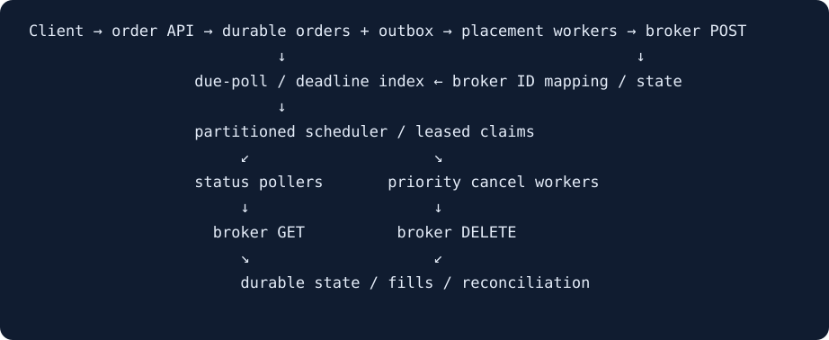

# W538. Stock Trading Agent Service with Order Deadlines

**Priority group:** Final 47 — complete coverage

**Category:** Trading and financial systems

**Study position:** 538 of 547

[Group list](../FINAL_47.md) · [All categories](../ALL_CATEGORIES.md) · [Chapter guide](../README.md)

## Question

Design an intermediary 'Stock Trading Agent' service that sits between clients and a third-party broker API.

### Requirements

1. Accept buy/sell orders from users; each order has a deadline (time limit).
2. Forward orders to the external Broker Service.
3. Poll order status until filled or the deadline passes.
4. If an order isn't filled by its deadline, automatically cancel it.
5. Handle thousands of orders expiring at the same time.

Broker API: GET /orders/{orderId} (pending/filled/cancelled), POST /orders (place), DELETE /orders/{orderId} (cancel). The broker does not push updates — you must poll.

Assumptions: backend only; peak ~10,000 orders/sec, avg ~2,000/sec (~173M/day); never lose an order; deadlines 1 min–24 h; 99.99% reliability.

Address: crash recovery, broker downtime/slowness, tracking thousands of deadlines efficiently, spikes when 10,000 orders expire in one second, DB↔broker reconciliation, idempotent retries (no double-buy), health checks, and partial fills.

## Worked solution

### State the broker-contract limits first

The listed broker API does **not** specify idempotency keys, lookup by client-order ID, partial-fill quantities or a server-enforced expiry. These are required to guarantee no duplicate buys after an ambiguous POST and to account for partial fills. Also, cancelling at a deadline cannot guarantee no fill after that instant if the broker is down or a fill races cancellation. Require broker-side expiry for a hard execution deadline; otherwise promise timely cancellation **attempts** and eventual reconciled outcome.

[Open the architecture diagram](../diagrams/W538_review_architecture.svg).

### Durable lifecycle and API

Accept `{client_key,side,symbol,quantity,deadline}` and persist immutable intent before submission. Repeat client keys return the same order only when the payload matches. Store internal/broker IDs, placement uncertainty, cumulative fills, next poll, deadline, attempt/lease generation and state. Expose status separately from acceptance.

With broker idempotency/client-ID support, replay the same placement operation after a crash. Without it, an uncertain POST must stop for reconciliation rather than risk a duplicate. Retain accepted intents until terminal state is verified. State transitions are versioned: PENDING → PARTIAL/FILLED, CANCEL_REQUESTED → CANCELLED or FILLED/PARTIAL as observed. Never convert a timeout directly into a confirmed cancellation.

### Poll and expire efficiently

Use indexed `next_poll_at` and deadline buckets or durable timing wheels. Workers claim batches under leases/fencing, schedule the next poll after completion and recover expired leases. There is no sleeping thread per order. Increase polling near deadlines, add jitter to noncritical polling and respect a global broker rate budget. Give cancels/reconciliation reserved capacity so ordinary polling cannot starve them.

At 2,000 orders/s average, the stated daily volume is 172.8 million. Active count is arrival rate times average unresolved lifetime: sixty seconds implies 120,000, while a day would imply 172.8 million if all remain unresolved that long. Polling 120,000 active orders every five seconds already needs 24,000 GETs/s. A daily volume number alone does not establish a feasible polling design; obtain broker quotas and active-lifetime distribution. At an assumed 200-byte compact record, new raw state alone is about 34.6 GB/day before indexes/history/replication.

Ten thousand simultaneous expiries require ten thousand cancel requests plus retries/status queries. Shard the due bucket, prefetch work, prioritize by deadline and provision negotiated broker capacity; do not shift the contractual deadline with jitter. If the broker cannot sustain that rate, the hard target is infeasible without broker-native expiry/batch operations.

### Partial fills, recovery and operations

Extend GET to include filled/remaining quantity and execution IDs, or add an execution feed/lookup. Cancel only remaining quantity, retain completed fills and reconcile charges/positions exactly once by execution ID. A late fill after a cancel request is possible and must be reflected to the user.

Crash recovery reclaims durable jobs, reconstructs timers from DB and reconciles uncertain sends/cancels. Health checks distinguish local readiness from broker availability; circuit breakers stop overload without dropping accepted intents. Monitor deadline-to-cancel-attempt delay, unresolved age, poll lag, broker errors, duplicate attempts and reconciliation differences. Test crashes around every external call, lease expiry, broker outage over a deadline, duplicate POST responses and fill/cancel races. The 99.99% reliability target must name the measured property—durable acceptance, eventual resolution or hard deadline execution—because the given API cannot guarantee all three unconditionally.
