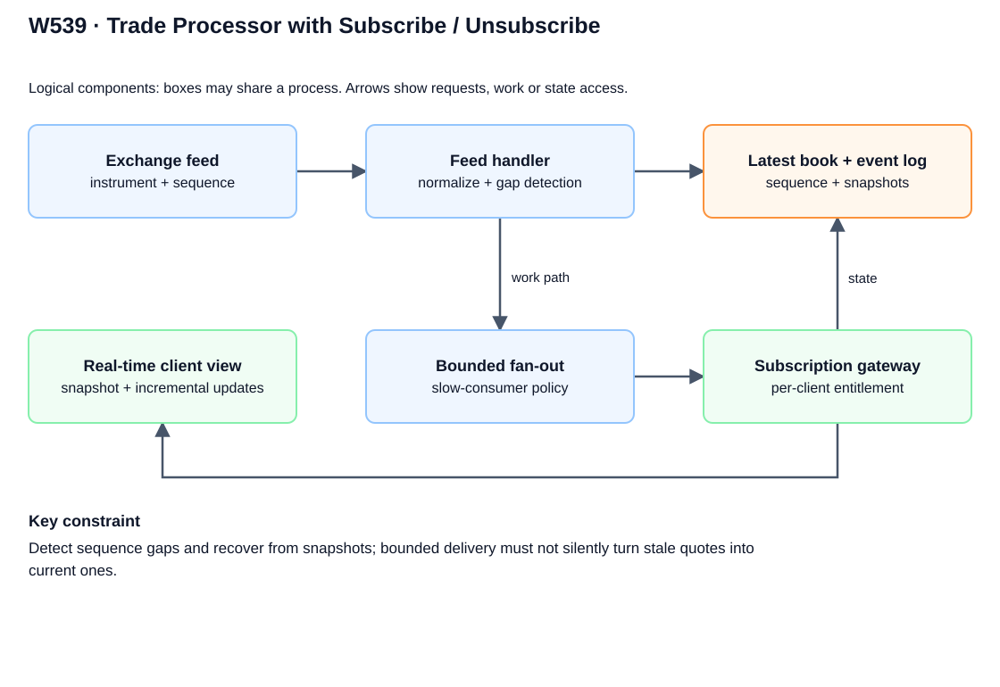

# W539. Trade Processor with Subscribe / Unsubscribe

**Priority group:** Final 47 — complete coverage

**Category:** Trading and financial systems

**Study position:** 539 of 547

[Group list](../FINAL_47.md) · [All categories](../ALL_CATEGORIES.md) · [Chapter guide](../README.md)

<span class="practice-page"></span>

## Question

Implement a TradeProcessor class. It accepts incoming trades, lets clients subscribe to trades matching a filter with a callback, returns a handle for the subscription, and supports unsubscription. This is a coding-flavored design round where the prompt is deliberately under-specified — clarification is half the work.

Reported interface:

using HANDLE = int;
struct Trade { string symbol; int size; string flag; };

```text
class TradeProcessor {
```

void onNewTrade(const Trade& trade);
HANDLE subscribe(const Trade& tradeFilter, function&lt;void(const Trade&)&gt; callback);
void unsubscribe(HANDLE handle);

```text
};
```

Clarify before coding: what does the filter match on (exact symbol? flag? prefix?), is onNewTrade single- or multi-threaded, are callbacks invoked synchronously inline or dispatched, and does unsubscribe guarantee no further callbacks fire after it returns.

## Worked solution

<!-- architecture:W539:start -->
### Architecture and request flow



[Open the diagram at full size](../diagrams/W539_architecture.svg). This is a baseline component diagram for this question. The boxes describe responsibilities; they do not require a separate microservice for every box.

- **Request and state:** Exchange feed — instrument + sequence → Feed handler — normalize + gap detection. That component consults or updates **Latest book + event log — sequence + snapshots** under the required access and consistency rules.
- **Work and result:** the work path passes through **Bounded fan-out — slow-consumer policy** and **Subscription gateway — per-client entitlement**, producing **Real-time client view — snapshot + incremental updates**. Bound waiting and retries where a slow dependency can stall this path.
- **Correctness point:** Detect sequence gaps and recover from snapshots; bounded delivery must not silently turn stale quotes into current ones.

When explaining the drawing, trace one normal request first, then a duplicate request, an unavailable dependency and recovery from saved state. If the question requires stricter guarantees or a different scope, state the change explicitly rather than treating this baseline as the only possible design.
<!-- architecture:W539:end -->


### Solution outline

1. Separate market-data ingestion, order intent, pre-trade validation, execution routing and reconciliation. Record sequence numbers and source timestamps; detect missing or out-of-order updates before publishing a book snapshot.
2. Validate limits, authorization, available balances and deadlines against authoritative state before orders can leave. Represent pending, acknowledged, partially filled, canceled and terminal states explicitly.
3. Use stable client order ids, idempotent event application and durable audit logs. A timeout is an unknown outcome until reconciled, not proof that an exchange rejected the order.
4. Partition work to minimize contention, benchmark tail latency and preserve correctness during failover. Explain risk limits as a system contract, not a recommendation to place trades.

### Understand why the approach works

#### Preserve order and enforce risk before an order leaves

Separate market-data state, user order intent, pre-trade checks, routing, execution reports and reconciliation. Feed sequence numbers and snapshots are needed to detect gaps; a fast stream of quotes is not necessarily a correct order book.

An order has a stable client id and states such as pending, acknowledged, partially filled, canceled and terminal. Apply fills idempotently and relate them to the accepted order version. A timeout means outcome unknown, not that the venue did nothing.

Validate authorization, limits, available resources and deadlines before transmission through the authoritative gate. Checking a hard risk constraint only after sending the order cannot prevent the breach. A stale leader must be fenced from sending conflicting instructions after failover.

Walk through a fill with a lost acknowledgment, a cancel arriving after a partial fill and a missing feed update. Explain what is persisted and what must be reconciled before proceeding. Optimize allocation, serialization and queueing under matched tail-latency measurements while preserving those invariants. These are architecture exercises; no unspecified market data or toy expected-value calculation establishes a real trading action or investment outcome.

### Work a small example

If an exchange fills an order and the network drops its acknowledgment, retrying with a new id can double the position. Query/reconcile the existing id before deciding the next action.

### Edge cases and common mistakes

Checking a risk limit only after sending an order, or processing duplicate fills as new trades.

### Check your reasoning on related cases

**Design idempotency for an order or booking API.** A timeout after successful booking should not create a second booking when the client retries the same key.

What if a downstream service is not transactional with your database? Use a durable state machine and reconciliation, not an unsupported exactly-once claim.

**Explain backpressure in a multi-stage data pipeline.** A producer at 1000 items/s feeding a sustained 800 items/s consumer adds 200 queued items every second.

What should an overload response include? A clear retry policy or status, rather than silent loss or indefinite waiting.

### Further study

- [F165: Design idempotency for an order or booking API.](../17_distributed_systems_depth.md#f165)
- [F169: Explain backpressure in a multi-stage data pipeline.](../17_distributed_systems_depth.md#f169)

### Explain it back

Close the answer. State the main invariant or equation, work the example with changed inputs, and explain which assumption would make your solution fail. For a design, walk through a retry or partial failure; for a derivative, check a shape and a finite-difference case.
