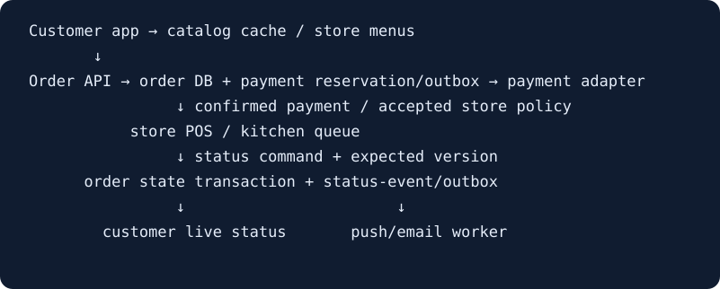

# W540. Coffee Ordering System Design

**Priority group:** Final 47 — complete coverage

**Category:** Web services and object design

**Study position:** 540 of 547

[Group list](../FINAL_47.md) · [All categories](../ALL_CATEGORIES.md) · [Chapter guide](../README.md)

<span class="practice-page"></span>

## Question

Salesforce's signature backend SD prompt: design an online coffee ordering / management service end-to-end. Interviewers compress the design into 30 minutes and then drill on SQL queries and edge cases ("customers who never ordered", "top spender last month"), so a clean ER model and explicit notification flow are weighted more than novel architecture.

### Requirements

Customer-facing flow: browse stores / menus, place an order, pay, track status, get notified on ready / pickup.
Store-side flow: receive order, update status (queued -&gt; preparing -&gt; ready -&gt; picked up), broadcast status changes.
Multi-store / multi-region support (many cities, not a single shop).
Catalog: items, modifiers (size, milk, syrup), per-store availability, per-store pricing.
Reporting / analytics endpoints — interviewers consistently ask for SQL during the round.
Common follow-ups: coordinate notification between customer app and store POS when an order is ready; scale the order-placement path under a morning commute spike; handle store-side cancellation / refund; auth and rate-limiting of the order API.

## Worked solution

### Model an order as a priced snapshot

Separate a menu item's identity from its per-store price/availability. Store customer, store, menu item, modifier option, store-offer, order, order-line, line-modifier, payment/refund and status-event entities. An order line snapshots the purchased name, price and modifier prices; a menu edit must not rewrite yesterday's receipt.



[Open the architecture diagram](../diagrams/W540_review_architecture.svg).

`POST /v1/orders` takes store, item/modifier IDs and quantities plus an idempotency key. Server-side code validates store hours, modifier compatibility, availability and prices, then stores an immutable total in minor currency units. Do not trust a customer-supplied total. Pay with a stable operation key and reconcile uncertain outcomes before retrying. Decide whether store acceptance precedes or follows capture, and compensate/release/refund if the later step fails.

### State and regional ownership

Use explicit transitions: pending payment/acceptance → queued → preparing → ready → picked up, with controlled cancelled/refund-pending paths. A ready command atomically advances the order version and creates a notification event. POS and customer devices consume that event with sequence IDs; missed pushes are recovered through status/history APIs. Do not make a successful kitchen transition depend on an email provider being available.

Assign each store/order a home region; replicate catalog/history as needed. Writes for one order remain serialized there, avoiding two regions independently marking it picked up/cancelled. Authorize customers only for their orders and store staff only for their stores. Rate-limit authenticated order submissions and use bounded per-store capacity/estimated-ready-time controls during a morning spike.

### SQL deep dives

Assume `orders(id,customer_id,store_id,status,currency,total_minor,paid_at)` and separately recorded successful refunds. Customers who have never placed an order:

```sql
SELECT c.id, c.name
FROM customers AS c
WHERE NOT EXISTS (
  SELECT 1 FROM orders AS o WHERE o.customer_id = c.id
);
```

Top spender last month, using supplied half-open UTC bounds derived from the reporting timezone and a single currency:

```sql
SELECT o.customer_id, SUM(o.total_minor) AS spent_minor
FROM orders AS o
WHERE o.paid_at >= :month_start
  AND o.paid_at < :next_month_start
  AND o.currency = :currency
  AND o.status IN ('queued','preparing','ready','picked_up')
GROUP BY o.customer_id
ORDER BY spent_minor DESC, o.customer_id
LIMIT 1;
```

Clarify whether spend means gross captured amount or net of refunds. For net spend, preaggregate refunds per order before joining; joining every line and every refund directly multiplies totals. Filtering current status alone can be inadequate for historical captured-spend reporting, so a mature implementation queries the payment ledger with a defined time basis. Index customer/order time and store/status queues according to access paths.

Cancellation checks current version/state, records the reason and creates an idempotent refund/release job; late payment callbacks reconcile instead of resurrecting a cancelled order blindly. Monitor store backlog, payment uncertainty, notification lag, duplicate submits and ledger totals.
