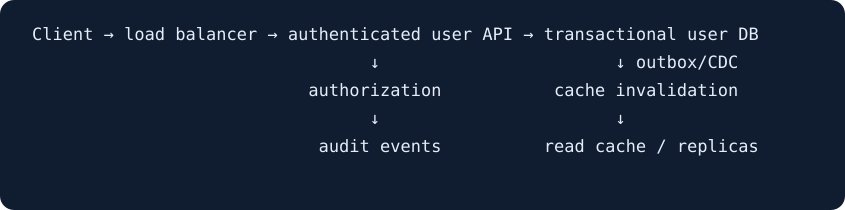

# W541. Concurrent User Management System Architecture Design

**Priority group:** Final 47 — complete coverage

**Category:** Web services and object design

**Study position:** 541 of 547

[Group list](../FINAL_47.md) · [All categories](../ALL_CATEGORIES.md) · [Chapter guide](../README.md)

<span class="practice-page"></span>

## Question

Design a system to support the following functions: add user, delete user, query user information, and update user information. The system should handle concurrent requests and ensure data consistency. Provide an architectural diagram (described) and explain the function of each module.

Example request
{"action": "add", "user": {"id": 1, "name": "Alice"}}

## Worked solution

### Use a transactional source of truth

Represent a user with a unique ID, normalized unique login/email where required, allowed profile fields, version and deletion state. Keep credential material separate from public profile fields. A stateless service validates requests and performs atomic writes to a replicated relational database; caches are derived and can be discarded.



[Open the architecture diagram](../diagrams/W541_review_architecture.svg).

### CRUD contract

Use `POST /v1/users`, `GET /v1/users/{id}`, `PATCH /v1/users/{id}` and `DELETE /v1/users/{id}`. The example add request maps to POST with a JSON body. Validate fields and reject mass assignment of privileged attributes. A unique database constraint decides concurrent duplicate creates; a client idempotency key makes retries return the same created resource when required.

Reads return an ETag/version. Updates include `If-Match` or an expected version and execute a conditional statement:

```sql
UPDATE users
SET display_name = :name, version = version + 1
WHERE id = :id AND version = :expected_version AND deleted_at IS NULL
RETURNING id, display_name, version;
```

Zero updated rows means missing/deleted or a version conflict; resolve it explicitly rather than silently overwriting another client's change. The same pattern protects deletion. Two different field edits may be safely merged by a documented policy, while competing writes to the same field need conflict handling. Transactions/constraints, not an in-process mutex on one API server, enforce consistency across replicas of the service.

### Cache, deletion and concurrency

For strict read-after-write semantics, route the requesting session to the primary/version-aware read path. An asynchronously replicated database or stale cache cannot promise an immediately current response by default. Write an outbox invalidation event in the same DB transaction; consumers invalidate by user/version so old events cannot repopulate newer data. Short TTLs bound residual staleness but do not eliminate it.

A soft-delete tombstone supports recovery/audit and prevents stale events from recreating a profile. Define which unique names can be reused and when personal data is purged, including derived copies. Authorize self-service versus admin operations separately from authenticating identity. Service-to-service calls also need scoped identities and access checks.

Scale reads with indexes/cache and writes by user-key ownership only when measured volume requires it. Failover needs a fenced database writer; two primaries accepting conflicting updates break the version invariant. Test simultaneous creates, two PATCHes with one version, update/delete races, retry after lost response and delayed cache events. Monitor conflict rate, errors, replication lag and audit completeness.
