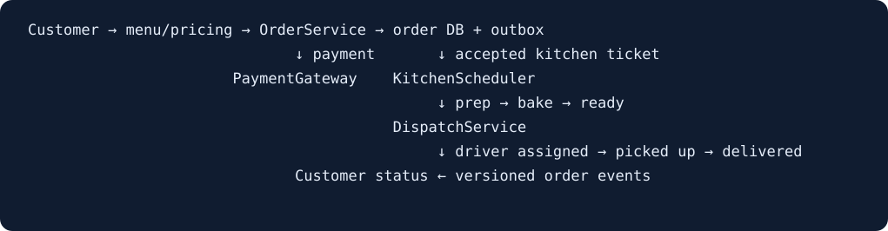

# W542. Design a Pizza Ordering and Fulfillment System (OOD)

**Priority group:** Final 47 — complete coverage

**Category:** Web services and object design

**Study position:** 542 of 547

[Group list](../FINAL_47.md) · [All categories](../ALL_CATEGORIES.md) · [Chapter guide](../README.md)

## Question

Design a pizza ordering and fulfillment system end-to-end — menu, order placement, kitchen workflow, and delivery handoff.

Customer flow: browse menu, customize a pizza (size, crust, toppings), place order, pay, track status.
Kitchen flow: assign orders to stations, advance through states (queued → prep → bake → ready), notify delivery.
Delivery flow: dispatch driver, track location, mark delivered.
Discuss the state machine that ties customer status to kitchen and delivery state.

The round pairs this OOD with Leadership-Principle behavioral questions on a deadline-driven project.

## Worked solution

### Separate domain objects from external services

Use `Menu`, `PizzaSpecification(size,crust,toppings)`, `PriceQuote`, `Order`, `OrderLine`, `KitchenTicket`, `DeliveryJob` and `PaymentAttempt`. `Order` owns allowed lifecycle transitions and immutable purchase snapshots. `PricingPolicy`, `PaymentGateway`, `KitchenScheduler`, `DispatchService` and `Notifier` are replaceable collaborators; an order should not inherit from a payment or driver.

[Open the architecture diagram](../diagrams/W542_review_architecture.svg).

### Define one coherent state machine

Order acceptance validates store service area/hours, size/crust/topping compatibility, availability and the server-calculated price. Store item/option price snapshots and money in exact minor units. Use a client idempotency key and an immutable payment operation key. Decide whether to authorize before kitchen acceptance and capture after acceptance; failed acceptance releases the authorization rather than charging an unfulfillable order.

A possible path is `PENDING_PAYMENT → ACCEPTED → QUEUED → PREPARING → BAKING → READY → OUT_FOR_DELIVERY → DELIVERED`. Kitchen and delivery can have separate detailed states, while the order exposes a validated derived customer state. Do not allow `DELIVERED` directly from `QUEUED`. Cancellation permissions depend on progress, with explicit compensation/refund rules instead of reversing a baked pizza into raw ingredients.

Kitchen work is split into station tasks with dependencies and a stable ticket ID. Claim a task atomically, respect oven capacity/batches and emit completion once. `READY` emits a dispatch event. Driver reservation is atomic by delivery ID; retries cannot assign two drivers. A pickup handoff verifies the correct driver/order, then updates delivery/order state under version checks. Location updates are approximate telemetry with freshness, not the authority that proves delivery.

### Persistence and failure handling

Persist order state/version and an outbox event in one transaction. Consumers deduplicate event IDs for kitchen tickets, driver jobs and notifications. Payment timeouts become uncertain attempts requiring reconciliation; they do not permit a fresh blind charge. A delayed kitchen event cannot regress a delivered order. If a driver disappears, reassign through a fenced reservation and tell the customer the updated ETA.

For multiple stores, each order has one store/region writer; menu availability and capacity are store-specific. Authorize customers, kitchen staff and drivers for their own tasks, with rate limits and an audit of transitions. Monitor queue age, oven saturation, ready-to-pickup delay, delivery ETA errors, cancellations, payment uncertainty and notification lag.

For the paired behavioral question, use a real deadline-driven project: scope, trade-off, your action, measurable outcome and lesson. That personal history is not supplied, so do not convert this hypothetical pizza design into an invented work accomplishment.
