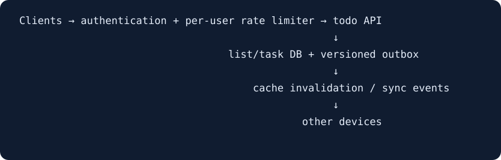

# W543. Design a Todo-List Full-Stack Service

**Priority group:** Final 47 — complete coverage

**Category:** Web services and object design

**Study position:** 543 of 547

[Group list](../FINAL_47.md) · [All categories](../ALL_CATEGORIES.md) · [Chapter guide](../README.md)

## Question

Design a todo-list service with: create a list, add tasks, view tasks, update tasks, delete tasks.

Non-functional / follow-up constraints:

A single user can generate ~500 requests/second — decide between rate limiting, caching, request coalescing, or a mix.
Lists need a stable ordering model so clients render predictably and reorder without corrupting concurrent edits.
REST APIs include a path version (/v1/...); explain what versioning protects and how backward compatibility is handled.
Distinguish user authentication from authorization, and handle service-to-service auth.
Cache design must handle staleness and invalidation after task updates/deletes.

## Worked solution

### API and ownership

Authenticate the caller, then authorize access to each list/task. Authentication proves identity; it does not mean the user owns every numeric ID in the URL. Service-to-service requests need their own workload identity and scoped permissions, not a shared all-powerful user token.

Use `POST /v1/lists`, `POST /v1/lists/{id}/tasks`, `GET /v1/lists/{id}/tasks`, `PATCH /v1/tasks/{id}` and `DELETE /v1/tasks/{id}`. Create calls support client idempotency keys; updates/deletes use an expected version/ETag. Version `/v1` protects published request/response semantics, not every internal deployment. Add optional fields compatibly; breaking meaning/removing required behavior needs migration and a version policy.

[Open the architecture diagram](../diagrams/W543_review_architecture.svg).

### Model stable ordering and edits

Store `lists(id,owner_id,version)` and `tasks(id,list_id,title,completed,order_key,version,deleted_at)`, plus membership if sharing is supported. Render by `(order_key,id)` for deterministic ties. Fractional/rank keys allow insertion between neighbors without renumbering every task, but keys eventually need compaction. A reorder request names task and neighboring IDs plus expected list version; validate membership and apply it transactionally, incrementing list version. Compaction must serialize with reorders so concurrent edits cannot scramble order.

Optimistic task versions prevent lost title/completion edits. A stale client gets a conflict/current state instead of overwriting unseen changes. Keep deletion tombstones/versions long enough for sync; an old update must not resurrect a deleted task.

### Handle five hundred requests/s from one user

First determine whether this is duplicate polling, autosave, legitimate bulk work or abuse. Apply a token-bucket limit with a documented burst and `429`/retry guidance. Cache/coalesce identical reads, use conditional GETs or push invalidations, debounce title autosaves and provide bounded bulk endpoints. Do not merge noncommuting create/delete/reorder operations indiscriminately: fewer requests are not worth incorrect intent.

The database remains the source of truth. Cache list pages by user/list/query and version; write an invalidation event transactionally with updates and avoid old events overwriting newer entries. For immediate read-after-write, return the committed object/version and use a primary/version-aware path. A TTL bounds stale reads but does not guarantee freshness. Use per-resource and total-account limits so one high-rate user cannot exhaust global capacity.

Test simultaneous task edits, reorder/rebalance races, update-after-delete, duplicate creation, unauthorized list access, stale cache replay and five-hundred-rps bursts. Monitor rate-limit responses, queueing, DB conflict/lock times, cache age and user-visible sync lag. Scale read replicas/caches only after defining the consistency each endpoint promises.
