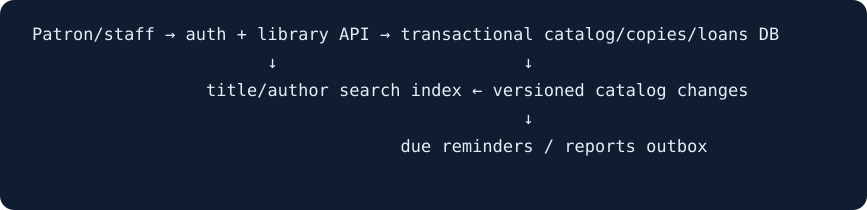

# W544. Library Book Management System Design and API Architecture

**Priority group:** Final 47 — complete coverage

**Category:** Web services and object design

**Study position:** 544 of 547

[Group list](../FINAL_47.md) · [All categories](../ALL_CATEGORIES.md) · [Chapter guide](../README.md)

<span class="practice-page"></span>

## Question

Library Book Management System Design and API Architecture

Please design a library book management system. The system should support the following functions:

Add new books, including title, author, and ISBN information.
Search books based on title, author, or ISBN.
Borrow books and record borrower information and borrowing date.
Manage borrowed books, support viewing the borrowing status, and handle book returns.

Requirements: Please design the database model and API architecture of the system. Consider the scalability of the system and resource lock management issues.

Example

### Input

Add new book: Title='1984', Author='George Orwell', ISBN='1234567890'

```python
def solution():
    # Read data from standard input
    # Write your code here
    pass
```

```text
if __name__ == "__main__":
```

solution()

## Worked solution

### Distinguish a book title from a physical copy

One ISBN can have several lendable copies. Model `books(id,isbn UNIQUE,title,...)`, `authors`, `book_authors`, `copies(id,book_id,branch_id,status,version)`, `borrowers`, and `loans(id,copy_id,borrower_id,borrowed_at,due_at,returned_at)`. Add a unique partial index on `loans(copy_id) WHERE returned_at IS NULL` to prevent two active loans of one copy. A copied title string is not an adequate inventory key.



[Open the architecture diagram](../diagrams/W544_review_architecture.svg).

### REST operations

`POST /v1/books` adds title/ISBN/authors; `POST /v1/books/{id}/copies` adds inventory. Normalize/check ISBN according to the accepted ISBN format; the prompt's ten-digit example is a field illustration, not proof of a valid real ISBN. `GET /v1/books?title=&author=&isbn=` searches catalog, with bounded pagination. `POST /v1/loans` takes copy/borrower and an idempotency key; `GET /v1/borrowers/{id}/loans?active=true` shows status; `POST /v1/loans/{id}/return` performs an idempotent return. Staff-only catalog writes differ from a borrower's own loan access.

### Borrow atomically

Within one transaction, lock the chosen copy row with `SELECT ... FOR UPDATE`, validate availability and borrower eligibility, insert the loan, and change copy state to ON_LOAN. Let the unique active-loan constraint provide a second line of defense. Do not hold a lock while making remote calls or waiting for human input. If automatically choosing a copy, use a bounded query/lock policy such as skip-locked selection with explicit “temporarily unavailable” behavior.

For return, lock the active loan/copy in a consistent order, set `returned_at` once and transition the copy to AVAILABLE or a hold/inspection state. A retry returns the existing result; it does not create another inventory item or charge a late fee twice. Compute any fees under a unique ledger operation, not a repeated arithmetic increment on every return request.

### Scale and resource-lock trade-offs

Index ISBN, book-author relationships, copy availability by branch and active borrower loans. A search index improves fuzzy title/author discovery but can lag; authoritative availability is checked in the borrow transaction. Cache catalog metadata separately from rapidly changing copy status. Partition by branch/copy ownership when scale requires it, while cross-branch holds/transfers need their own workflow.

Test two patrons borrowing the same last copy, duplicate borrow/return requests, transaction crash, lock timeout and stale search availability. Use consistent lock order, short transactions and bounded retry on deadlock/conflict. SQL transactions and uniqueness must enforce inventory correctness across API instances; a mutex in one web process is insufficient. The generic stdin stub supplies no CLI protocol, so the requested deliverable is this database/API design rather than an invented parser.
