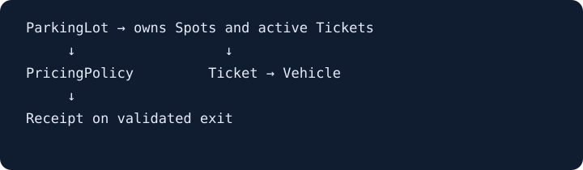

# W545. Object-Oriented Design Round

**Priority group:** Final 47 — complete coverage

**Category:** Web services and object design

**Study position:** 545 of 547

[Group list](../FINAL_47.md) · [All categories](../ALL_CATEGORIES.md) · [Chapter guide](../README.md)

<span class="practice-page"></span>

## Question

A Microsoft staple: some Azure loops replace a coding round with an explicit object-oriented design prompt — design class hierarchies, interfaces, and inheritance relationships for a small system, in code.

Common prompt families:

A parking lot system (cars / motorcycles / trucks; spot tiers; pricing).
A library catalog with checkout / hold / overdue behavior.
A vending machine with payment + inventory + state transitions.
A plug-in chess-piece interface (implement piece movement behind a common interface).

The interviewer evaluates class/interface/abstract-class boundaries, inheritance vs composition tradeoffs, SOLID principles applied without name-dropping, state-machine encoding, and extensibility to a follow-up requirement dropped mid-round. Code is expected, not just diagrams.

## Worked solution

### Choose a prompt and implement its core

Choose the parking-lot family. Represent vehicle size and required features as data; represent a parking spot's capacity/features as data plus a compatibility method. Compose the lot with a pricing policy so adding a pricing rule does not require subclassing every vehicle or rewriting allocation.



[Open the architecture diagram](../diagrams/W545_review_architecture.svg).

### Runnable implementation

[Download the implementation and checks](../parking_545.py).

```python
"""W545 parking OOD with composition and a lock-protected in-memory store."""

from dataclasses import dataclass
from enum import IntEnum
import math
import threading


class VehicleSize(IntEnum):
    MOTORCYCLE = 0
    CAR = 1
    TRUCK = 2


@dataclass(frozen=True)
class Vehicle:
    plate: str
    size: VehicleSize
    required_features: frozenset = frozenset()


@dataclass(frozen=True)
class Spot:
    identifier: str
    capacity: VehicleSize
    features: frozenset = frozenset()

    def accepts(self, vehicle):
        return (
            self.capacity >= vehicle.size and vehicle.required_features <= self.features
        )


@dataclass(frozen=True)
class Ticket:
    identifier: int
    spot_id: str
    vehicle: Vehicle
    start_seconds: float


class HourlyPricing:
    def __init__(self, minor_units_per_hour):
        self.rate = minor_units_per_hour

    def cost(self, ticket, end_seconds):
        if end_seconds < ticket.start_seconds:
            raise ValueError("Time moved backwards")
        return (
            max(1, math.ceil((end_seconds - ticket.start_seconds) / 3600)) * self.rate
        )


class ParkingLot:
    def __init__(self, spots, pricing):
        self.spots = {spot.identifier: spot for spot in spots}
        if len(self.spots) != len(spots):
            raise ValueError("Duplicate spot ID")
        self.pricing = pricing
        self.active = {}
        self.receipts = {}
        self.next_id = 1
        self.lock = threading.Lock()

    def park(self, vehicle, now_seconds):
        with self.lock:
            if any(t.vehicle.plate == vehicle.plate for t in self.active.values()):
                raise ValueError("Vehicle already parked")
            occupied = {t.spot_id for t in self.active.values()}
            choices = [
                s
                for s in self.spots.values()
                if s.identifier not in occupied and s.accepts(vehicle)
            ]
            if not choices:
                raise ValueError("No compatible free spot")
            spot = min(choices, key=lambda s: (s.capacity, s.identifier))
            ticket = Ticket(self.next_id, spot.identifier, vehicle, now_seconds)
            self.next_id += 1
            self.active[ticket.identifier] = ticket
            return ticket

    def leave(self, ticket_id, now_seconds):
        with self.lock:
            if ticket_id in self.receipts:
                return self.receipts[ticket_id]
            ticket = self.active[ticket_id]
            amount = self.pricing.cost(ticket, now_seconds)
            receipt = dict(
                ticket_id=ticket_id, amount_minor=amount, spot_id=ticket.spot_id
            )
            self.receipts[ticket_id] = receipt
            del self.active[ticket_id]
            return receipt


if __name__ == "__main__":
    lot = ParkingLot(
        [Spot("C", VehicleSize.CAR), Spot("T", VehicleSize.TRUCK)], HourlyPricing(200)
    )
    car = lot.park(Vehicle("A", VehicleSize.CAR), 0)
    assert car.spot_id == "C"
    truck = lot.park(Vehicle("B", VehicleSize.TRUCK), 0)
    assert truck.spot_id == "T"
    try:
        lot.park(Vehicle("C", VehicleSize.CAR), 0)
        raise AssertionError("Expected full")
    except ValueError:
        pass
    first = lot.leave(car.identifier, 3601)
    assert first["amount_minor"] == 400
    assert lot.leave(car.identifier, 9999) == first
    ev = ParkingLot(
        [Spot("EV", VehicleSize.CAR, frozenset({"charger"}))], HourlyPricing(300)
    )
    assert (
        ev.park(Vehicle("E", VehicleSize.CAR, frozenset({"charger"})), 0).spot_id
        == "EV"
    )
    print("W545 fitting, full lot, pricing, retry and EV composition checks passed")
```

The allocator chooses the smallest compatible free spot, preserving large spots where possible. One lock makes checking availability and creating the ticket atomic inside this process. Release calculates price before changing occupancy, stores a receipt and returns that same receipt on retry. A price failure therefore does not accidentally free a spot. The sample uses exact minor currency units and a stated minimum-one-hour policy.

### Explain the boundaries and follow-up

A vehicle is not a spot, and a payment is not a parking lot: avoid inheritance for unrelated responsibilities. A protocol/abstract interface for `cost(ticket,end)` is useful when several pricing implementations exist; the duck-typed collaborator keeps the small example readable. A database repository/payment gateway can be introduced when persistence/charging becomes part of the prompt, without moving those concerns into `Vehicle`.

For EV spaces, add a `charger` feature to a spot and required vehicle features; the test shows this extension without a separate hierarchy of `ElectricCar`, `ElectricCarSpot` and `ElectricCarPricingLot`. For accessible parking, eligibility is an independently validated requirement, not a feature a client can simply claim.

The tests cover fit, full capacity, deterministic smallest-spot allocation, pricing, retry-safe exit and the feature extension. It is an in-memory interview model: restarting loses state, plate identity is simplified, and returning the mutable receipt object is a boundary to copy/serialize in a service. Multiple processes require transactional spot reservations/unique occupancy constraints and durable idempotency keys rather than this single-process lock. External payment uncertainty needs a payment state machine; computing a fee is not the same as capturing it.
