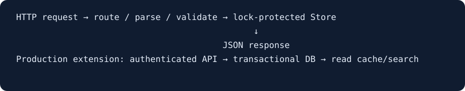

# W546. Runnable Stack Overflow / Quora REST Service

**Priority group:** Final 47 — complete coverage

**Category:** Web services and object design

**Study position:** 546 of 547

[Group list](../FINAL_47.md) · [All categories](../ALL_CATEGORIES.md) · [Chapter guide](../README.md)

<span class="practice-page"></span>

## Question

Implement a runnable REST service live in your own framework (Flask, Spring Boot, or even Python http.server). Build a Stack Overflow / Quora-like system where users post questions and query them, with create/query and voting-style (upvote/downvote) operations.

The implementation portion is roughly the first 45 minutes; the rest is backend discussion. Follow-up topics: database schema, indexes, authentication/security, request handling, rate limiting, simple scaling.

Have routing, JSON body parsing, status codes, and in-memory storage ready. Demonstrate with curl/Postman/Thunder Client.

## Worked solution

### Build the small service before discussing a large architecture

Implement questions, paginated search and one vote value per user/question. A vote endpoint **sets** the user's vote to -1, zero or one rather than incrementing a global counter, so a retried upvote does not add two points. The runnable example uses only Python's standard library and in-memory storage, as permitted by the prompt.



[Open the architecture diagram](../diagrams/W546_review_architecture.svg).

### Complete runnable implementation

[Download the service](../questions_546.py), then run `python questions_546.py`. It listens only on localhost port 8080. Data resets on restart. The `X-Demo-User` header is deliberately **not real authentication**; any caller can forge it, so the sample must not be exposed as a secure public service.

```python
"""W546 runnable standard-library REST demo. python questions_546.py"""
from http.server import BaseHTTPRequestHandler,ThreadingHTTPServer
from urllib.parse import urlparse,parse_qs
import json
import threading

class Store:
    def __init__(self):
        self.questions={};self.votes={};self.next_id=1;self.lock=threading.RLock()
    def create(self,title,body,author):
        if not isinstance(title,str) or not title.strip() or not isinstance(body,str):
            raise ValueError('Need nonempty title and string body')
        if len(title)>300 or len(body)>20000:raise ValueError('Question too long')
        with self.lock:
            identifier=self.next_id;self.next_id+=1
            self.questions[identifier]=dict(id=identifier,title=title.strip(),body=body,author=author)
            return self.get(identifier)
    def get(self,identifier):
        with self.lock:
            question=self.questions[identifier].copy()
            question['score']=sum(v for (qid,user),v in self.votes.items() if qid==identifier)
            return question
    def search(self,query='',offset=0,limit=20):
        with self.lock:
            ids=[i for i,q in self.questions.items()
                 if query.casefold() in (q['title']+' '+q['body']).casefold()]
            return dict(items=[self.get(i) for i in ids[offset:offset+limit]],total=len(ids))
    def vote(self,identifier,user,value):
        if type(value) is not int or value not in (-1,0,1):raise ValueError('Vote must be -1, 0 or 1')
        with self.lock:
            if identifier not in self.questions:raise KeyError(identifier)
            self.votes[identifier,user]=value  # set/replace rather than increment
            return self.get(identifier)

def handler_for(store):
 class Handler(BaseHTTPRequestHandler):
    def log_message(self,*args):pass
    def send_json(self,status,payload):
        body=json.dumps(payload).encode()
        self.send_response(status);self.send_header('Content-Type','application/json')
        self.send_header('Content-Length',str(len(body)));self.end_headers();self.wfile.write(body)
    def do_GET(self):self.dispatch()
    def do_POST(self):self.dispatch()
    def do_PUT(self):self.dispatch()
    def dispatch(self):
        try:
            parsed=urlparse(self.path);parts=parsed.path.strip('/').split('/')
            data={}
            if self.command in ('POST','PUT'):
                size=int(self.headers.get('Content-Length','0'))
                if not 0<size<=65536:
                    self.send_json(413,{'error':'Body must be 1..65536 bytes'});return
                data=json.loads(self.rfile.read(size))
                if not isinstance(data,dict):raise ValueError('Expected JSON object')
            if self.command=='GET' and parts==['questions']:
                query=parse_qs(parsed.query)
                offset=int(query.get('offset',['0'])[0]);limit=int(query.get('limit',['20'])[0])
                if offset<0 or not 1<=limit<=100:raise ValueError('Invalid pagination')
                self.send_json(200,store.search(query.get('q',[''])[0],offset,limit));return
            if self.command=='GET' and len(parts)==2 and parts[0]=='questions':
                self.send_json(200,store.get(int(parts[1])));return
            # DEMO identity only: callers can forge this header. Replace with real auth in deployment.
            user=self.headers.get('X-Demo-User')
            if not user:
                self.send_json(401,{'error':'X-Demo-User is required for this local demo'});return
            if self.command=='POST' and parts==['questions']:
                if set(data)!={'title','body'}:raise ValueError('Expected title and body only')
                self.send_json(201,store.create(data['title'],data['body'],user));return
            if self.command=='PUT' and len(parts)==3 and parts[0]=='questions' and parts[2]=='vote':
                if set(data)!={'value'}:raise ValueError('Expected value only')
                self.send_json(200,store.vote(int(parts[1]),user,data['value']));return
            self.send_json(404,{'error':'Route not found'})
        except KeyError:self.send_json(404,{'error':'Question not found'})
        except (ValueError,UnicodeDecodeError) as error:self.send_json(400,{'error':str(error)})
 return Handler

if __name__=='__main__':
    server=ThreadingHTTPServer(('127.0.0.1',8080),handler_for(Store()))
    print('Local demo at http://127.0.0.1:8080; data resets on restart')
    server.serve_forever()

```

### Demonstrate the endpoints

```sh
curl -X POST http://127.0.0.1:8080/questions \
  -H 'Content-Type: application/json' -H 'X-Demo-User: alice' \
  -d '{"title":"Why shift softmax logits?","body":"Explain numerical stability."}'
curl 'http://127.0.0.1:8080/questions?q=softmax&limit=20'
curl -X PUT http://127.0.0.1:8080/questions/1/vote \
  -H 'Content-Type: application/json' -H 'X-Demo-User: bob' -d '{"value":1}'
```

Creation returns 201; queries/votes return 200; malformed input returns 400, missing demo identity 401 and unknown resources 404. Repeating the last request leaves score one. Replacing it with -1 changes the same user's contribution to -1. The integration test runs these through an actual local HTTP server and also checks missing identity, invalid votes and search.

### Backend discussion

A persistent schema needs users, questions `(id,author_id,title,body,created_at)` and votes with primary key `(question_id,user_id)` plus a checked vote value. Use a transaction/upsert for vote changes. Aggregate score from votes initially or maintain it transactionally by the **difference** between new and old values. Add an author/time index, bounded cursor pagination and a search index when substring scanning is insufficient. Questions/votes need durable backups; this in-memory demo intentionally loses them on restart.

Use real session/token authentication, authorize edits/deletes, validate lengths/types, render user content safely and rate-limit posting/voting/search separately. Limit request-body size, set server timeouts and use a production HTTP server/reverse proxy. The demo's global lock is correct only for its one process; multiple API replicas need database constraints and transactions. Cache reads and fan out invalidations as necessary, while keeping vote identity/uniqueness in the authoritative store. Optional question-create idempotency keys prevent duplicate posts after a lost response; that extension is separate from the implemented idempotent vote semantics.
