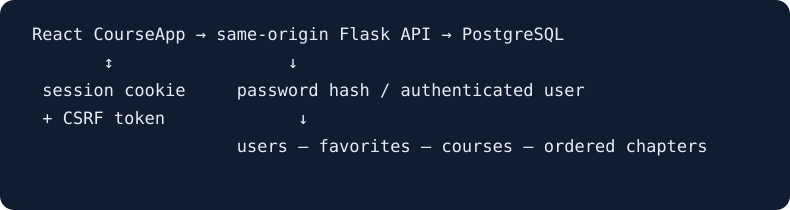

# W547. University Course Platform: User Auth, Courses, Favorites API & DB Design

**Priority group:** Final 47 — complete coverage

**Category:** Web services and object design

**Study position:** 547 of 547

[Group list](../FINAL_47.md) · [All categories](../ALL_CATEGORIES.md) · [Chapter guide](../README.md)

<span class="practice-page"></span>

## Question

You are a developer responsible for implementing a university online course project. Please use the React JS frontend framework, combined with Rails or Flask backend, and PostgreSQL database to complete the following features:

User registration and login system, with session management.
Course list display, supporting category browsing.
Single course detail page display, including course introduction, chapter list, and chapter details.
Users can favorite courses, with support for viewing the favorite list.

Please design at least two RESTful API endpoints and provide the corresponding database design.

Test Cases
Create a user and log in, ensuring the session is valid.
View and search the course list, confirming the functionality is effective.
Browse course details.
Favorite and unfavorite courses, verifying the updates in the favorite list.
Example

### Input

POST /register {"username": "user1", "password": "pass"}

## Worked solution

### Choose one coherent stack

Use React with a Flask JSON API and PostgreSQL through SQLAlchemy. Serve frontend and API under the same origin so browser session cookies work without an unnecessary cross-origin authentication setup. The implementation below includes registration/login/logout, CSRF protection, course/category/search APIs, chapter details and per-user favorites. It returns plain chapter text; React escapes it instead of injecting arbitrary HTML.



[Open the architecture diagram](../diagrams/W547_review_architecture.svg).

### Database and endpoint contract

`users` has unique normalized username and a password hash. `courses` contains title, category and introduction. `chapters` references its course and has a unique `(course_id,position)` ordering. `favorites` has composite primary key `(user_id,course_id)`, preventing duplicate favorites, and foreign keys with deletion behavior.

The API exposes `GET /api/csrf`, `POST /api/register`, `POST /api/login`, `POST /api/logout`, `GET /api/courses?q=&category=&page=`, `GET /api/courses/{id}`, `GET /api/favorites` and `PUT`/`DELETE /api/favorites/{course_id}`. Mutations require the session's CSRF token. Favorite ownership comes from the authenticated session, never a user ID supplied in the request body.

### Flask implementation

[Download the backend](../course_547.py). Install Flask, SQLAlchemy and psycopg, provision PostgreSQL, set `DATABASE_URL` to a `postgresql+psycopg://...` connection string and set a strong secret in `SECRET_KEY`. Do not embed real credentials in the study file. Set `HTTPS_COOKIES=1` behind HTTPS in deployment; the default permits local HTTP study.

```python
"""W547 Flask + SQLAlchemy. Set DATABASE_URL to PostgreSQL for deployment."""
import os
import secrets
from flask import Flask,request,session,jsonify
from sqlalchemy import (create_engine,Column,Integer,String,Text,ForeignKey,
                        UniqueConstraint,select,or_,event)
from sqlalchemy.orm import declarative_base,sessionmaker
from sqlalchemy.exc import IntegrityError
from werkzeug.security import generate_password_hash,check_password_hash

Base=declarative_base()
class User(Base):
    __tablename__='users'
    id=Column(Integer,primary_key=True)
    username=Column(String(100),unique=True,nullable=False)
    password_hash=Column(Text,nullable=False)
class Course(Base):
    __tablename__='courses'
    id=Column(Integer,primary_key=True);title=Column(String(300),nullable=False)
    category=Column(String(100),nullable=False,index=True);introduction=Column(Text,nullable=False)
class Chapter(Base):
    __tablename__='chapters'
    id=Column(Integer,primary_key=True);course_id=Column(ForeignKey('courses.id',ondelete='CASCADE'),nullable=False,index=True)
    position=Column(Integer,nullable=False);title=Column(String(300),nullable=False);body=Column(Text,nullable=False)
    __table_args__=(UniqueConstraint('course_id','position'),)
class Favorite(Base):
    __tablename__='favorites'
    user_id=Column(ForeignKey('users.id',ondelete='CASCADE'),primary_key=True)
    course_id=Column(ForeignKey('courses.id',ondelete='CASCADE'),primary_key=True,index=True)

def create_app(database_url,secret_key,secure_cookies=False):
    app=Flask(__name__)
    app.config.update(SECRET_KEY=secret_key,SESSION_COOKIE_HTTPONLY=True,
        SESSION_COOKIE_SAMESITE='Lax',SESSION_COOKIE_SECURE=secure_cookies,MAX_CONTENT_LENGTH=65536)
    engine=create_engine(database_url)
    if engine.dialect.name=='sqlite':
        @event.listens_for(engine,'connect')
        def sqlite_foreign_keys(connection,record):connection.execute('PRAGMA foreign_keys=ON')
    Base.metadata.create_all(engine)  # use reviewed migrations rather than this at production startup
    DB=sessionmaker(engine)
    app.extensions['course_db']=DB
    def current_user(db):
        uid=session.get('user_id')
        return db.get(User,uid) if uid is not None else None
    def body():
        value=request.get_json(silent=True)
        return value if isinstance(value,dict) else {}
    @app.before_request
    def csrf_check():
        # Token required on registration/login too; protects login CSRF.
        if request.method in ('POST','PUT','DELETE','PATCH'):
            supplied=request.headers.get('X-CSRF-Token','')
            expected=session.get('csrf')
            if not expected or not secrets.compare_digest(supplied,expected):
                return jsonify(error='Invalid CSRF token'),403
    @app.get('/api/csrf')
    def csrf():
        session.setdefault('csrf',secrets.token_hex(24))
        return jsonify(csrf=session['csrf'])
    @app.post('/api/register')
    def register():
        data=body();name=data.get('username');password=data.get('password')
        if not isinstance(name,str) or not name.strip() or len(name)>100 or not isinstance(password,str) or not 8<=len(password)<=200:
            return jsonify(error='Need username and password of 8..200 characters'),400
        with DB.begin() as db:
            user=User(username=name.strip().casefold(),password_hash=generate_password_hash(password))
            db.add(user)
            try:db.flush()
            except IntegrityError:
                db.rollback();return jsonify(error='Username unavailable'),409
            uid=user.id
        return jsonify(id=uid),201
    @app.post('/api/login')
    def login():
        data=body();name=data.get('username');password=data.get('password')
        if not isinstance(name,str) or not isinstance(password,str):return jsonify(error='Invalid credentials'),401
        with DB() as db:
            user=db.scalar(select(User).where(User.username==name.strip().casefold()))
            if user is None or not check_password_hash(user.password_hash,password):
                return jsonify(error='Invalid credentials'),401
            uid=user.id
        session.clear();session.update(user_id=uid,csrf=secrets.token_hex(24))
        return jsonify(id=uid,csrf=session['csrf'])
    @app.post('/api/logout')
    def logout():session.clear();return '',204
    @app.get('/api/courses')
    def courses():
        query=request.args.get('q','');category=request.args.get('category')
        try:page=max(0,int(request.args.get('page',0)))
        except ValueError:return jsonify(error='Invalid page'),400
        statement=select(Course)
        if category:statement=statement.where(Course.category==category)
        if query:statement=statement.where(or_(Course.title.icontains(query,autoescape=True),Course.introduction.icontains(query,autoescape=True)))
        with DB() as db:
            rows=db.scalars(statement.order_by(Course.id).offset(page*20).limit(20)).all()
            return jsonify(items=[dict(id=c.id,title=c.title,category=c.category) for c in rows])
    @app.get('/api/courses/<int:course_id>')
    def detail(course_id):
        with DB() as db:
            course=db.get(Course,course_id)
            if course is None:return jsonify(error='Not found'),404
            chapters=db.scalars(select(Chapter).where(Chapter.course_id==course_id).order_by(Chapter.position)).all()
            return jsonify(id=course.id,title=course.title,introduction=course.introduction,
                chapters=[dict(id=c.id,title=c.title,position=c.position,body=c.body) for c in chapters])
    @app.route('/api/favorites/<int:course_id>',methods=['PUT','DELETE'])
    def favorite(course_id):
        with DB.begin() as db:
            user=current_user(db)
            if user is None:return jsonify(error='Login required'),401
            if db.get(Course,course_id) is None:return jsonify(error='Not found'),404
            # Lock user row serializes concurrent favorite changes in PostgreSQL.
            db.scalar(select(User).where(User.id==user.id).with_for_update())
            existing=db.get(Favorite,(user.id,course_id))
            if request.method=='PUT' and existing is None:db.add(Favorite(user_id=user.id,course_id=course_id))
            if request.method=='DELETE' and existing is not None:db.delete(existing)
        return '',204
    @app.get('/api/favorites')
    def favorites():
        with DB() as db:
            user=current_user(db)
            if user is None:return jsonify(error='Login required'),401
            rows=db.scalars(select(Course).join(Favorite,Favorite.course_id==Course.id)
                            .where(Favorite.user_id==user.id).order_by(Course.id)).all()
            return jsonify(items=[dict(id=c.id,title=c.title,category=c.category) for c in rows])
    return app

if __name__=='__main__':
    app=create_app(os.environ['DATABASE_URL'],os.environ['SECRET_KEY'],
                   secure_cookies=os.environ.get('HTTPS_COOKIES')=='1')
    app.run(host='127.0.0.1',port=5000,debug=False)

```

A production deployment uses reviewed migrations, not uncoordinated `create_all` on every startup. The schema is defined by the mapped classes above; seed courses/chapters through an authorized management command using `app.extensions['course_db']`. No public catalog-write endpoint is included because it is outside the requested student workflow.

### React frontend

[Download the React component](../CourseApp547.jsx) and mount it in an existing React build. Proxy `/api` to Flask during local frontend development or serve both under one origin.

```jsx
import React,{useEffect,useRef,useState} from 'react';
export function CourseApp() {
  const csrf=useRef('');
  const detailRequest=useRef(0);
  const [user,setUser]=useState(null),[message,setMessage]=useState('');
  const [username,setUsername]=useState(''),[password,setPassword]=useState('');
  const [query,setQuery]=useState(''),[category,setCategory]=useState('');
  const [view,setView]=useState('courses'),[items,setItems]=useState([]);
  const [detail,setDetail]=useState(null),[revision,setRevision]=useState(0);
  async function api(path,method='GET',body,signal) {
    const response=await fetch('/api'+path,{method,credentials:'same-origin',signal,
      headers:{'Content-Type':'application/json',...(method==='GET'?{}:{'X-CSRF-Token':csrf.current})},
      ...(body===undefined?{}:{body:JSON.stringify(body)})});
    const data=response.status===204?null:await response.json();
    if(!response.ok) throw new Error(data?.error || `HTTP ${response.status}`);
    return data;
  }
  useEffect(()=>{let live=true;
    api('/csrf').then(data=>{if(live)csrf.current=data.csrf;}).catch(e=>setMessage(e.message));
    return ()=>{live=false;};
  },[]);
  useEffect(()=>{
    const abort=new AbortController();
    const timer=setTimeout(()=>{
      const params=new URLSearchParams({q:query,category});
      api(view==='favorites'?'/favorites':`/courses?${params}`,'GET',undefined,abort.signal)
        .then(data=>{if(!abort.signal.aborted){setItems(data.items);setMessage('');}})
        .catch(e=>{if(!abort.signal.aborted)setMessage(e.message);});
    },200);
    return ()=>{clearTimeout(timer);abort.abort();};
  },[query,category,view,revision]);
  async function authenticate(register) {
    try {
      if(!csrf.current)csrf.current=(await api('/csrf')).csrf;
      if(register)await api('/register','POST',{username,password});
      const data=await api('/login','POST',{username,password});
      csrf.current=data.csrf;setUser(data.id);setPassword('');setMessage('Logged in');
      setRevision(r=>r+1);
    } catch(error){setMessage(error.message);}
  }
  async function showCourse(id) {
    const request=++detailRequest.current;
    try{const data=await api(`/courses/${id}`);if(request===detailRequest.current)setDetail(data);}
    catch(error){if(request===detailRequest.current)setMessage(error.message);}
  }
  async function favorite(id,remove=false) {
    try{await api(`/favorites/${id}`,remove?'DELETE':'PUT');setMessage(remove?'Favorite removed':'Favorited');setRevision(r=>r+1);}
    catch(error){setMessage(error.message);}
  }
  return <main>
    <h1>Courses</h1>
    {!user?<form onSubmit={e=>{e.preventDefault();authenticate(false);}}>
      <label>Username <input autoComplete="username" value={username} onChange={e=>setUsername(e.target.value)}/></label>
      <label>Password <input type="password" autoComplete="current-password" value={password} onChange={e=>setPassword(e.target.value)}/></label>
      <button type="submit">Log in</button>
      <button type="button" onClick={()=>authenticate(true)}>Register and log in</button>
    </form>:<button onClick={async()=>{
      try{await api('/logout','POST');csrf.current=(await api('/csrf')).csrf;setUser(null);setView('courses');}
      catch(e){setMessage(e.message);}
    }}>Log out</button>}
    <p role="status">{message}</p>
    <nav><button onClick={()=>setView('courses')}>Browse</button>
      <button disabled={!user} onClick={()=>setView('favorites')}>My favorites</button></nav>
    {view==='courses'&&<section>
      <label>Search <input value={query} onChange={e=>setQuery(e.target.value)}/></label>
      <label>Category <input value={category} onChange={e=>setCategory(e.target.value)} placeholder="e.g. ML"/></label>
    </section>}
    <ul>{items.map(item=><li key={item.id}>
      <button onClick={()=>showCourse(item.id)}>{item.title}</button> {item.category}
      {user&&<button onClick={()=>favorite(item.id,view==='favorites')}>
        {view==='favorites'?'Unfavorite':'Favorite'}</button>}
    </li>)}</ul>
    {detail&&<article><h2>{detail.title}</h2><p>{detail.introduction}</p>
      {detail.chapters.map(chapter=><details key={chapter.id}>
        <summary>{chapter.title}</summary><p>{chapter.body}</p></details>)}
    </article>}
  </main>;
}

```

The component debounces catalog queries and aborts obsolete requests. It stores only the active UI inputs/results and treats server session checks as authoritative. Login rotates the session/CSRF value; subsequent writes use the returned token. The list API is paginated at twenty rows; add page controls for a larger catalog and scope favorite-list pagination similarly. Client-only `user` state is display state, not a security boundary, and a production app should add a session-status endpoint to restore that display after reload.

### Verify the complete flow and its limits

The companion [integration tests](../test_services_501_547.py) create/register/login a user, check the session cookie and CSRF rotation, search/browse a course, read chapter content, favorite twice without duplication, unfavorite and log out. They run against a declared temporary SQLite fixture using the same ORM/application code. PostgreSQL-specific row locking/concurrent favorite behavior still requires PostgreSQL integration tests; SQLite passing does not verify those semantics.

The prompt's `"pass"` is an example payload, not a secure password policy. This implementation rejects it and uses an eight-character minimum for the demo. Add production password policy, rate limiting, account recovery, abuse controls and validated email/identity requirements as the product needs. Flask's signed cookie session is not encrypted storage; keep only identifiers/CSRF state there. For immediate centralized session revocation, use server-side sessions with appropriate storage. Keep secrets and personal data out of logs, enforce least-privilege database access and test concurrent writes on the deployed database before publishing the application.
